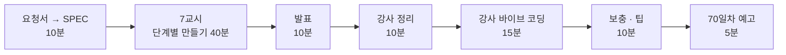

# 7·8교시 · 바이브 코딩 (`tcrew`)

- 교시: 7교시 16:00~16:50 (각자 만들기), 8교시 17:00~17:50 (발표 · 정리 · 강사 바이브 코딩 · 팁 · 예고)
- 과제: [VIBE-REQ-TCREW](../../Last3Mon/69/VIBE-REQ-TCREW.md)(요청서) → 학생이 직접 쓰는 `SPEC.md` → [VIBE-Q-TCREW](../../Last3Mon/69/VIBE-Q-TCREW.md)(요구 · 단계)와 비교 → 만들기 → 수업 뒤 `VIBE-A-TCREW.md` 공개
- 68일차와 같은 흐름입니다: 사람의 말(요청서)을 **확인할 수 있는 요구**로 바꾸는 일을 학생이 먼저 하고, VIBE-Q는 그 다음 단계(비교 대상)로 씁니다.
- 오늘은 `tcrew`: 질문 하나를 **작성자 → 검토자 → 정리자** LLM이 차례로 처리하고 역할별 탭으로 보여 주는 TUI. 역할 지시문은 `crew.yaml`. 오늘 n8n 공지 팀을 파이썬으로 다시 만드는 셈입니다.

## 1. 7교시 · 각자 만들기 (50분)

| 시간 | 단계 | 확인 |
| --- | --- | --- |
| 16:00~16:02 | 0. 준비 (`~/vibe/tcrew`, `git init`). **에이전트는 아직 켜지 않음** | |
| 16:02~16:12 | 0. 요청서 → `SPEC.md` (직접) → VIBE-Q와 비교 · 고치기 · commit | 요구마다 확인 방법(호출 순서 · 횟수 · 파일), 숨은 요구, 비교한 줄 |
| 16:12~16:23 | 1. YAML · 차례로 부르기 (R1). 첫 요청은 "SPEC.md를 읽고 확인 방법부터 말해" | `uv run tcrew "..." --plain`, 가짜 LLM 테스트 |
| 16:23~16:35 | 2. 검토 · 고쳐 쓰기 · 기록 (R3 · R5) | "항상 FIX" 검토자로 한 번만 고치고 멈춤 |
| 16:35~16:45 | 3. TUI 탭 (R2 · R4) | `translator` 추가 → 탭 4개 |
| 16:45~16:50 | 4. 정리 · `SPEC.md` 체크 · 발표 메모 | |

16:00에 화면에 띄울 것: 요청서의 ①~⑤와 예 하나(① → R1). "부탁은 확인할 수 없습니다. 호출 순서 · 횟수 · 파일로 바꿉니다." 16:10쯤 "VIBE-Q를 열어 비교하세요"를 알립니다.

| 볼 것 | 막혔을 때 한마디 |
| --- | --- |
| SPEC 없이 VIBE-Q를 통째로 붙여 넣었나 | "요청서로 SPEC.md부터. 확인 방법이 없으면 됐는지 모릅니다" |
| SPEC에 부탁만 ("끝없이 주고받지 않게") | "늘 FIX인 검토자면 LLM이 몇 번 불려야 하나요? 숫자로" |
| 검토 답을 프로그램이 못 읽음 | "첫 줄 PASS/FIX처럼 읽을 수 있는 모양으로, 아니면 FIX로 보게" |
| 끝없이 고쳐 씀 | "고쳐 쓰기 횟수를 YAML에, 코드가 지키게" |
| 역할 이름이 코드에 박힘 | "translator를 YAML에만 넣고 돌려 보세요" |
| 테스트가 진짜 LLM을 부름 | "가짜 LLM으로 순서만 확인" |
| 실행해 보지 않고 다음 요청 | "에이전트가 됐다고 해도 직접 `uv run tcrew`" |

수업 준비 때 tcrew를 미리 만들어 보지는 않았습니다. 강사 바이브 코딩(4절)에서 걸린 시간을 재어 정답본(`VIBE-A-TCREW.md`)에 남깁니다.

## 2. 8교시 · 발표 (10분)

- 1~2명. **검토 답 읽기나 고쳐 쓰기 멈춤을 스스로 푼 사람**을 먼저 고릅니다.
- 3분 발표 · 2분 질문: **내 SPEC과 VIBE-Q가 달랐던 곳** / 잘 먹힌 요청문 / 안 먹힌 요청문 / 에이전트가 틀린 곳 / `notice-phone` 사실로 시연.

## 3. 강사 정리 (10분)

| | n8n 공지 팀 | tcrew |
| --- | --- | --- |
| 요청 분석 | 상황 → 역할 카드 (Lab 01 예제 1) | 요청서 → SPEC.md (요구 · 숨은 요구 · 범위 밖 · 순서) |
| 역할 정의 | 역할마다 워크플로우 + 지시문 | `crew.yaml` 역할 목록 |
| 이어 붙이기 | HTTP로 다음 역할 호출 | 앞 답 → 다음 입력 |
| 읽을 수 있는 검토 | `passed`, `codes` | 첫 줄 PASS/FIX (또는 JSON) |
| 고쳐 쓰기 한 번 | 노드를 따로 (`Revise draft`) | `max_revisions: 1` |
| fail-closed | 검토 결과가 없으면 게시 안 함 | 못 읽은 검토는 FIX |
| 기록 | `steps`, `first_codes`, Executions | `runs/*.json` |
| 바꿔 끼우기 | 같은 계약이면 다른 사람 역할도 | 가짜 LLM ↔ OpenAI |

## 4. 강사 바이브 코딩 (15분)

| 주제 | 요청문 요지 | 보여 줄 것 |
| --- | --- | --- |
| 역할별 모델 | "crew.yaml 역할마다 model 을 다르게(검토자만 더 큰 모델), 비용·시간 표" | 역할 분리의 장점: 역할마다 다른 비용 (75일차 예고) |
| n8n 연결 | "tcrew 의 writer 를 n8n my-writer 웹훅으로 바꿔 끼우기(kind: http)" | 같은 계약이면 LLM 역할과 n8n 역할을 섞어 씀 |
| tflow로 보기 | "어제 tflow 로 오늘 my-work/notice.json 열기, 고쳐 쓰기 경로 확인" | 어제 도구를 오늘 확인에 씀 |

걸린 시간과 결과를 `Last3Mon/69/VIBE-A-TCREW.md`에 적어 둡니다.

## 5. 보충 · 팁 (10분)

| 팁 | 설명 |
| --- | --- |
| 요청서 → 요구가 먼저 | 확인 방법(호출 순서 · 횟수 · 파일)이 있는 요구가 있어야 에이전트의 "완료"를 판단할 수 있음 |
| 설정과 코드를 나누기 | 지시문·순서는 YAML, 코드는 실행만 → 비개발자도 역할을 고침 |
| 다음 단계가 읽을 모양 | LLM 답을 사람이 아니라 **프로그램**이 읽는다면 모양을 정해 줌 |
| 정해진 횟수 | 고쳐 쓰기·재시도는 항상 상한 |
| 모르면 멈춤 | 읽지 못한 검토는 통과가 아님 |
| 기록 남기기 | 누가 무엇을 받아 무엇을 냈나 → 나중에 원인 찾기 |

## 6. 70일차 예고 (5분)

- 오늘: 역할 카드와 협업 흐름. 내일: **템플릿화와 모듈화** — 오늘의 작성자·검토자를 다른 공지(보안 안내, 교육 안내)에도 다시 쓰는 구조.
- 바이브 코딩: `tkit` (템플릿 폴더를 골라 변수를 넣으면 새 n8n 워크플로우·프로젝트 뼈대를 만드는 TUI). 오늘 `my-work/*.json`을 템플릿 재료로 씁니다. 지우지 마세요.

## 확인 (강사)

- [ ] 7교시 시작 전 `OPENAI_API_KEY` 꺼내는 명령을 화면에 띄웠다 (키 값은 띄우지 않음).
- [ ] 16:00 요청서 → SPEC 10분을 지켰다 (에이전트 없이), 16:10 VIBE-Q 비교 알림.
- [ ] 발표자 1~2명, 강사 정리 표, 강사 바이브 코딩 1개(시간 기록), 팁, 예고.
- [ ] 수업 뒤: `VIBE-A-TCREW.md`의 "자주 빠뜨리는 것"·강사 바이브 코딩 시간을 채우고 **학생 저장소에 VIBE-A만** 올린다 (LAB-A는 올리지 않음).
