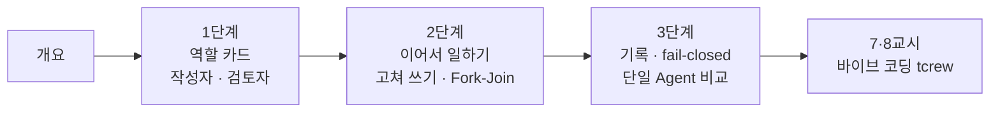

# 69일차 · 역할 기반 Agent 분리와 협업 워크플로우 설계 (바이브 코딩)

- 일자: 2026-10-21 (69일차)
- 교과목: 노코드 멀티 에이전트 워크플로우 설계 및 운영
- 단원: 운영·확장 관점의 AI 워크플로우 설계 고도화
- 학습 내용: 역할 기반 Agent 분리, 업무 분배 및 협업 Workflow 설계
- 실습 폴더: [Last3Mon/69](../../Last3Mon/69/README.md)
- 실습 환경: 65일차 n8n 2.42.6 + OpenAI API(`gpt-4.1-mini`) + **CLI 코딩 에이전트**(Codex · Claude Code · Antigravity 중 하나)
- **실습 준비: [00-DAY69-PREP.md](00-DAY69-PREP.md) (수업 전날까지 1~2절 완료)**
- 65~68일차를 못 한 수강생: [PREPARE-69-FROM-65.md](../../Last3Mon/69/PREPARE-69-FROM-65.md) (n8n 설치 · Credential · CLI 에이전트, 약 25분)
- 개념이 헷갈리면: [CONCEPT-69.md](CONCEPT-69.md)

## 오늘의 시간표

| 교시 | 시간 | 내용 | 자료 |
| --- | --- | --- | --- |
| 1 | 09:00~09:50 | 오늘의 개요 · 1단계 · 역할 기반 Agent 분리 | [개요](00-DAY69-OVERVIEW.md), [1단계](01-STAGE1-ROLE-SEPARATION.md) |
| 2 | 10:00~10:50 | 1단계 · Lab 01 (역할 카드, 작성자, 과제: 검토자) | [Lab 01](../../Last3Mon/69/LAB-01-Q-ROLE-CARDS.md) |
| 3 | 11:00~11:50 | 2단계 · 업무 분배와 협업 워크플로우, Lab 02 예제 1·2 | [2단계](02-STAGE2-COLLABORATION.md), [Lab 02](../../Last3Mon/69/LAB-02-Q-COLLABORATION.md) |
| 4 | 12:00~12:50 | 2단계 · Lab 02 과제 35분 (정리자 Fork-Join) · 풀이 | [Lab 02](../../Last3Mon/69/LAB-02-Q-COLLABORATION.md) |
| - | 13:00~14:00 | 점심 |  |
| 5 | 14:00~14:50 | 3단계 · 협업 검증과 역할 분리의 값, Lab 03 예제 1·2 | [3단계](03-STAGE3-VERIFY-AND-COMPARE.md), [Lab 03](../../Last3Mon/69/LAB-03-Q-TRACE-AND-COMPARE.md) |
| 6 | 15:00~15:50 | 3단계 · Lab 03 과제 40분 (어려운 테스트, 단일 Agent 비교) · 풀이 | [Lab 03](../../Last3Mon/69/LAB-03-Q-TRACE-AND-COMPARE.md) |
| 7 | 16:00~16:50 | 바이브 코딩 · `tcrew` 만들기 (각자, 요청서 → SPEC 먼저) | [VIBE-REQ-TCREW](../../Last3Mon/69/VIBE-REQ-TCREW.md) → [VIBE-Q-TCREW](../../Last3Mon/69/VIBE-Q-TCREW.md), [진행](04-VIBE-CODING.md) |
| 8 | 17:00~17:50 | 바이브 코딩 발표 · 정리 · 강사 바이브 코딩 · 팁 · 70일차 예고 | [진행](04-VIBE-CODING.md) |

## 자료 목록

| 파일 | 내용 |
| --- | --- |
| `00-DAY69-PREP.md` | 실습 준비: n8n 켜기, `flow.py doctor` (수업 전) |
| `00-DAY69-OVERVIEW.md` | 개요 13장 (PPT 대신 Markdown, 가로줄로 장 구분) |
| `01-STAGE1-ROLE-SEPARATION.md` | 왜 역할로 나누나, 역할 카드, 하지 않는 일, 규칙 검토와 LLM 검토, LLM 검토자도 틀린다 |
| `02-STAGE2-COLLABORATION.md` | 68일차 분배와 오늘 협업의 차이, 파이프라인, 고쳐 쓰기 1회, 넘기는 값의 출처, Fork-Join |
| `03-STAGE3-VERIFY-AND-COMPARE.md` | 협업 기록, fail-open과 fail-closed, 어려운 테스트, 단일 Agent와 비교 (측정값) |
| `04-VIBE-CODING.md` | 7·8교시 바이브 코딩 진행 (tcrew), 발표, 강사 정리, 추가 바이브 코딩, 팁 |
| `CONCEPT-69.md` | 개념 정리: 분배와 협업, 역할 카드, 규칙 검토와 LLM 검토, fail-open과 fail-closed, Fork-Join, 역할 팀과 단일 Agent |
