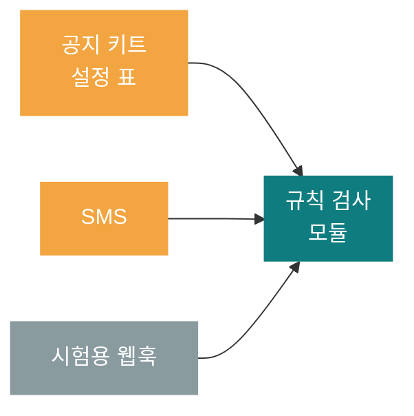
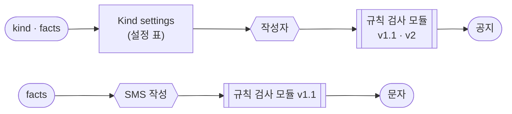
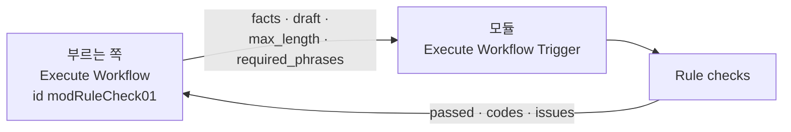

# 70일차 개요 · Workflow 템플릿화와 모듈화

> 운영·확장 관점의 AI 워크플로우 설계 고도화 · 2026-10-22
> 13장 · 각 장은 가로줄(`---`)로 나뉩니다. 1교시에는 1~5장을 보고, 나머지 장은 각 단계를 설명할 때 함께 띄웁니다.

| 장 | 범위 |
| --- | --- |
| 1~5 | 표지 · 목표 · 시간표 · 복사의 비용 · 오늘의 그림 |
| 6~7 | 1단계 · 템플릿화 |
| 8~9 | 2단계 · 모듈화 |
| 10~11 | 3단계 · 변경 관리 |
| 12~13 | 7교시 바이브 코딩 · 정리와 예고 |

---

## 1 / 13 · 표지



**70일차**

# Workflow 템플릿화와 모듈화

같은 것과 다른 것 · 설정 표 · Sub-workflow 모듈 · 계약 · 하위 호환 · 버전

<sub>운영·확장 관점의 AI 워크플로우 설계 고도화 · 2026-10-22</sub>

---

## 2 / 13 · 오늘 할 수 있게 될 세 가지

| | 오늘 할 수 있게 될 것 |
| :-: | --- |
| **①** | 복사본에서 같은 것·다른 것을 찾아 **설정 표 하나**로 여러 종류를 처리하는 워크플로우로 만든다 |
| **②** | 여러 곳에서 쓰는 일을 **모듈**(Sub-workflow)로 떼어 따로 시험하고, 두 워크플로우가 함께 쓴다 |
| **③** | 모듈을 바꿀 때 **하위 호환**은 같은 id로, **깨지는 변경**은 새 버전으로 두고 영향 받는 테스트를 모두 돌린다 |

---

## 3 / 13 · 오늘의 시간표

| ① 1~2교시 | ② 3~4교시 | ③ 5~6교시 | ④ 7~8교시 |
| --- | --- | --- | --- |
| **1단계** | **2단계** | **3단계** | **바이브 코딩** |
| 템플릿화 | 모듈화 | 변경 관리 | `tkit` |
| Lab 01 복사본 → 공지 키트 | Lab 02 모듈 · SMS | Lab 03 v1.1 · v2 · 영향 표 | 만들기 · 발표 · 정리 |

> 09:00 시작 · 50분 수업 10분 휴식 · 4교시 뒤 13:00~14:00 점심

---

## 4 / 13 · 복사의 비용

`samples/`: 69일차 공지 팀을 점검·보안·교육용으로 복사한 3개 (파일에서 비교한 값)

| | |
| --- | --- |
| 노드 | 9개, 이름은 모두 같음 |
| 다른 노드 | 4개 (웹훅 경로, 작성자 지시문, 규칙 검사 코드, 결과의 종류) |
| 같은 값이 두 곳에 | 꼭 넣을 문장이 지시문과 검사 코드에 따로 |
| 공통 규칙 하나 더하기 | 6곳 (파일 3개 × 지시문·검사) |

> 복사는 처음에는 빠르고, 고칠 때 비쌉니다.

---

## 5 / 13 · 오늘의 그림



> Lab 01(설정 표) → Lab 02(모듈, 두 번째 사용처) → Lab 03(모듈 바꾸기) 순서로 완성합니다.

---

## 6 / 13 · 1단계 · 같은 것, 다른 것, 우연히 다른 것

| 분류 | 예 | 어디로 |
| --- | --- | --- |
| 같은 것 | 흐름(웹훅 → 작성 → 검사 → 결과), 날짜·연락처 검사 | 그대로 하나 · 여러 곳에서 쓰면 모듈 |
| 종류마다 다른 것 | 머리말, 최대 길이, 꼭 넣을 문장 | **설정 표** |
| 우연히 다른 것 | 한 파일만 고친 규칙, 오타 | 복사가 만든 버그 → 하나로 맞춤 |

---

## 7 / 13 · 1단계 · 설정 표와 없는 값 (수업 준비 측정)

| | 결과 |
| --- | --- |
| 공지 키트 (표 3줄) `lab01` | 5/5 |
| 표에 없는 `survey`를 보냄 (예제) | 머리말·익명 문장 없이 **그대로 게시** |
| 표에 한 줄 + 없는 종류는 400과 목록 | `lab01-challenge` 1/4 → 4/4 |

> 표에 없는 종류는 규칙도 없습니다. 없으면 멈추고, 있는 종류를 알려 줍니다.

---

## 8 / 13 · 2단계 · Sub-workflow 모듈



| 확인 (n8n 2.42.6) | |
| --- | --- |
| 웹훅 없는 모듈도 push로 게시되고 불러짐 | ✔ |
| 시험용 웹훅으로 모듈만 시험 `lab02-module` | 5/5, 0.1초 (LLM 없음) |
| 키트가 모듈을 부르게 바꾼 뒤 `lab01` | 5/5 → 5/5 (테스트 수정 없음) |

---

## 9 / 13 · 2단계 · 두 번째 사용처: SMS

| | 공지 키트 | SMS |
| --- | --- | --- |
| 모듈 | 같은 `modRuleCheck01` | 같은 `modRuleCheck01` |
| `max_length` | 설정 표 (500~800) | 80 |
| `required_phrases` | 설정 표 | `[]` |
| 테스트 | `lab01` 5/5 | `lab02-challenge` 4/4 |

> 다른 값은 모듈 **안**이 아니라 **입력**으로. 모듈 안에 "SMS면 80"이 들어가면 쓰는 곳이 늘 때마다 모듈을 고칩니다.

---

## 10 / 13 · 3단계 · 하위 호환 변경 (같은 id)

사외 링크 금지: 새 입력 `allowed_domains`(없으면 `intra.example.com`), 새 코드 `external_link`

| 수업 준비 때 | 결과 |
| --- | --- |
| 처음 (`new URL()`로 호스트 읽기) | `lab03` 2/4 — 사내 링크도 막음 (Code 노드에 `URL` 없음) |
| 글자로 호스트 자르기 | 4/4 |
| push 직후 쓰는 곳 모두 | 모듈 시험 5/5 · 키트 5/5 · SMS 4/4 |

---

## 11 / 13 · 3단계 · 깨지는 변경은 v2 (새 id)

| | v1.1 (`modRuleCheck01`) | v2 (`modRuleCheck02`) |
| --- | --- | --- |
| 결과 | `passed`, `codes`, `issues` | `passed`, `blocking`, `warnings`, `issues` |
| `too_long` | 막음 | 경고 |
| 쓰는 곳 | SMS, 시험용 웹훅 | 공지 키트, v2 시험용 웹훅 |

> 수업 준비 때: 키트를 v2로 옮기며 키트 결과의 `codes`를 빼자 `lab01` **2/5**. `codes`를 남기고 새 필드를 **더해** 5/5. 계약은 층마다 있습니다.

---

## 12 / 13 · 7교시 · 바이브 코딩 `tkit`

```text
$ tkit ~/vibe/templates
▸ n8n-notice-kit   name: [training-mail]  prefix: [[교육 신청 확인]]  max_length: [400]
```

- 템플릿 폴더 + `template.yaml` → 변수를 채워 새 파일 (cookiecutter 방식)
- 가장 까다로운 곳: 템플릿 변수와 n8n 표현식 `{{ }}`이 겹침

---

## 13 / 13 · 정리와 71일차 예고

| 오늘 | 한 줄 |
| --- | --- |
| 1단계 | 다른 것은 설정 표 한 곳에, 표에 없으면 멈춘다 |
| 2단계 | 여러 곳에서 쓰는 일은 모듈로, 다른 값은 입력으로, 시험용 웹훅으로 따로 시험 |
| 3단계 | 하위 호환은 같은 id, 깨지는 변경은 새 id. 바꾸면 영향 표의 테스트를 모두 |

- 71일차: **RAG 기반 검색·응답** — 사내 규정 문서를 검색해 근거와 함께 답하기 · 바이브 코딩 `tdoc`
