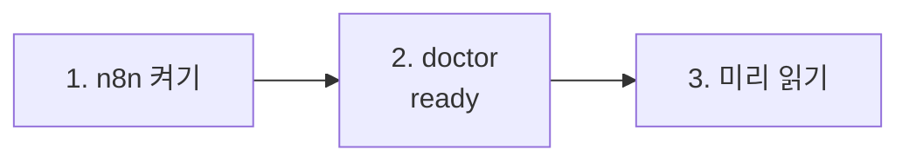

# 70일차 실습 준비 · 수업 전에 미리 해 두면 좋은 것

- 수업일: 2026-10-22 (70일차) · Workflow 템플릿화와 모듈화, 재사용 가능한 구조 설계
- 준비 시간: 약 10분 (69일차 준비를 했다면 1·2절만)
- 먼저 WSL에서 `cd ~/aio-01d4-stu && git pull`로 오늘 자료를 받습니다 (수강생 저장소: https://gl.isitsoft.kr/publicproj/aio-01d4-stu).
- **수업 전날까지** 1~2절을 끝내 주세요.



---

## 1. n8n 켜기 (전날 필수, 2분)

오늘은 데이터 API를 쓰지 않습니다 (켜 두어도 됩니다).

```bash
sudo systemctl disable --now ollama 2>/dev/null   # WSL에 설치한 Ollama가 있으면 끄고 자동 시작도 끔
cd ~/aio-01d4-stu/Last3Mon/65/n8n
docker compose rm -sf ollama                      # Ollama 컨테이너가 있으면 지움 (없으면 그냥 지나감)
docker compose start
```

- **66일차부터 LLM은 OpenAI API 키(`Last3Mon/.env`, Credential `OpenAI (.env)`)만 씁니다.** Ollama는 쓰지 않으므로 위처럼 꺼서 메모리를 아낍니다. 다음 날부터는 같은 명령을 그대로 써도 됩니다.
- `.../day65-n8n/compose.yml: no such file or directory` → 홈이 아닌 곳에 설치함. `Last3Mon/65/n8n/.env`에 `N8N_HOME=<설치 폴더>` ([67일차 준비](../67/00-DAY67-PREP.md) 1절).

## 2. 준비 확인 (전날 필수, 2분)

```bash
cd ~/aio-01d4-stu/Last3Mon/70
uv run tools/flow.py doctor
```

```text
✔ n8n install folder /home/<사용자>/day65-n8n
✔ n8n container day65-n8n-n8n-1
✔ n8n http://localhost:5678
! data API http://localhost:8800 (not used today)    ← 켜 두었다면 ✔
✔ credential 'OpenAI (.env)' (openAiCourse0001)
✔ node catalog (for check)
✔ CLI coding agent: codex, claude
ready
```

| ✘ 항목 | 할 일 |
| --- | --- |
| n8n container | 1절 |
| credential | `cd ~/aio-01d4-stu/Last3Mon/65/n8n && bash register-credentials.sh` |
| CLI coding agent | [67일차 준비](../67/00-DAY67-PREP.md) 2절 |

---

## 3. 미리 읽어 오면 좋은 내용 (선택, 약 5분)

### 3.1 복사해서 고친 워크플로우

69일차 공지 팀을 보안 공지용으로 쓰고 싶다면, 보통 복사해서 머리말과 규칙을 고칩니다. 교육 공지, 설문 공지도 그렇게 하면 파일이 4개가 됩니다. 이때 **모든 공지에 같은 규칙**(예: 사외 링크 금지)을 더하려면 몇 곳을 고쳐야 할까요?

### 3.2 용어

| 용어 | 한 줄 설명 |
| --- | --- |
| 템플릿화 | 같은 흐름은 하나로 두고, 다른 값만 **설정**으로 뺌 |
| 모듈 (Sub-workflow) | 여러 워크플로우가 **불러 쓰는** 워크플로우. n8n의 Execute Workflow · Execute Workflow Trigger |
| 계약 | 모듈의 입력·결과 이름과 모양 |
| 하위 호환 | 모듈을 바꿔도 예전 호출이 그대로 동작 |
| 버전 | 깨지는 변경은 새 id로 나란히 두고 쓰는 곳을 하나씩 옮김 |

## 4. 당일 준비물

- 충전된 노트북과 충전기, WSL의 Docker, Windows Terminal(WSL) 창 **두 개**, 웹 브라우저
- (선택) 69일차 `Last3Mon/69/my-work/*.json` 공지 팀 (오늘 `samples/`와 비교해 볼 수 있음), 68일차 `~/vibe/tflow`

## 확인

- [ ] `docker compose start` 후 http://localhost:5678 이 열린다
- [ ] `uv run tools/flow.py doctor`에서 n8n · credential · CLI 에이전트가 ✔
