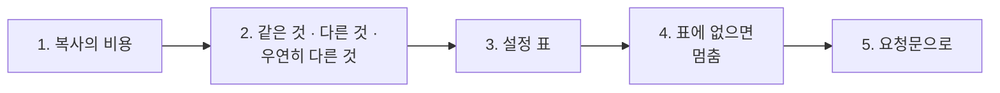
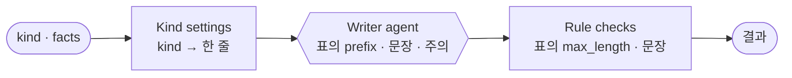

# 1단계 · 템플릿화: 같은 것과 다른 것 나누기

- 교시: 1~2교시 (09:00~10:50)
- 실습: [Lab 01](../../Last3Mon/70/LAB-01-Q-TEMPLATE-KIT.md)
- 이 단계가 끝나면: 복사해서 고친 워크플로우에서 같은 것과 다른 것을 찾고, 다른 것만 **설정 표**로 빼서 하나의 워크플로우로 만들 수 있다.



## 1. 복사의 비용

공지 팀(69일차)이 잘 동작하자 보안 공지, 교육 공지에도 쓰고 싶어졌습니다. 가장 쉬운 방법은 파일을 복사해서 조금 고치는 것입니다. `samples/`의 세 파일이 그렇게 만든 것입니다.

| 파일에서 비교한 값 | |
| --- | --- |
| 노드 | 세 파일 모두 9개, 이름 같음 |
| 다른 노드 | 4개: `Notice webhook`(경로), `Writer agent`(지시문의 머리말·꼭 넣을 문장·주의), `Rule checks`(최대 길이·꼭 넣을 문장), `Build result`(종류 이름) |
| 같은 값이 두 곳에 | 꼭 넣을 문장이 지시문과 검사 코드에 **따로** |

| 할 일 | 복사본 3개 | 템플릿 1개 |
| --- | --- | --- |
| 공통 규칙 하나 더하기 (예: 사외 링크 금지) | 6곳 (파일 3 × 지시문·검사) | 1곳 (2단계에서는 모듈 1곳) |
| 새 종류 더하기 | 파일 하나 더 복사 | 표 한 줄 |
| 한쪽만 고친 실수 | 찾기 어려움 | 생기지 않음 |

## 2. 같은 것 · 다른 것 · 우연히 다른 것

| 분류 | 묻는 것 | 예 | 처리 |
| --- | --- | --- | --- |
| 같은 것 | 모든 종류에서 같아야 하나? | 흐름, 날짜·연락처 검사 | 하나로 (여러 워크플로우가 쓰면 모듈, 2단계) |
| 종류마다 다른 것 | 업무상 종류마다 달라야 하나? | 머리말, 최대 길이, 꼭 넣을 문장, 주의 | **설정 표** |
| 우연히 다른 것 | 같아야 하는데 다르게 되어 있나? | 한 파일만 고친 규칙, 오타 | 복사가 만든 버그 → 하나로 맞춤 |

에이전트에게 비교를 맡길 때는 **노드 단위로**, 업무상 뜻과 함께, 동작과 상관없는 차이(위치, id)는 빼고 달라고 합니다. 표를 받은 뒤 분류는 사람이 합니다.

## 3. 설정 표



| kind | prefix | max_length | required_phrases |
| --- | --- | --- | --- |
| maintenance | `[점검 안내]` | 600 | — |
| security | `[보안 안내]` | 500 | IT팀은 절대 비밀번호를 묻지 않습니다. |
| training | `[교육 안내]` | 800 | 신청은 IT 포털에서 할 수 있습니다. |

- 표는 **한 곳**(Code 노드 `Kind settings`)에만. 작성자 지시문과 검사가 **같은 표**를 읽습니다. 지시문에 값을 다시 쓰면 복사가 다시 생깁니다.
- 공통 지시문에는 종류 이야기를 넣지 않습니다 ("머리말은 주어진 prefix로 시작").

수업 준비 때 공지 키트(표 3줄): `cases/lab01.json` 5/5, 1.4~3.8초.

## 4. 표에 없으면 멈춘다

예제 상태의 키트에 표에 없는 `survey`, `party`를 보내면 **공지를 써서 게시**했습니다 (수업 준비 측정, `lab01-challenge` 1/4). 표에 없으니 머리말도, 꼭 넣을 문장도, 길이 제한도 없고, 검사할 것도 없어 통과했습니다.

| 할 일 | 방법 |
| --- | --- |
| 새 종류 | 표에 한 줄 (`survey`) |
| 없는 종류 | 400 + `kinds` 목록 (목록은 **표에서** 만들어야 종류를 더할 때 따로 고치지 않음) |

고친 뒤 4/4. 없는 종류는 0.2초 (LLM을 부르지 않음).

> 템플릿은 "값만 바꾸면 된다"가 장점이지만, **값이 없을 때**를 정하지 않으면 조용히 틀린 결과를 냅니다.

## 5. 요청문으로

Lab과 다른 업무(사내 교육 신청 확인 메일)로 예를 듭니다.

```text
samples/ 를 보지 말고, my-work/course-mail.json 을 만들어 줘.
① 파일: my-work/course-mail.json
② 입력: POST 웹훅 my-course-mail, 본문 course(과정 코드), name(신청자). 둘 다 필수.
③ 처리: 과정마다 다른 것은 Code "Course settings" 표 한 곳에만:
   n8n-basic → 제목 "[n8n 기초] 신청 확인", 장소 "본관 3층", 준비물 "노트북"
   rag-intro → 제목 "[RAG 입문] 신청 확인", 장소 "별관 2층", 준비물 "없음"
   메일 본문을 쓰는 LLM 지시문은 공통 문장만, 값은 표에서 읽는다.
   표에 없는 course 면 400 {"error": "unknown course", "courses": 표의 키 목록}.
④ 결과: {"course", "subject", "body"}
⑤ 기대 결과: cases/course-mail.json
```

- "값은 **한 곳에만**", "지시문은 **공통 문장만**", "표에 없으면"을 적었습니다. 이 세 줄이 템플릿화의 요점입니다.

## 정리

- [ ] 복사본은 고칠 때 비싸다: 같은 값이 여러 곳에
- [ ] 같은 것 · 종류마다 다른 것 · 우연히 다른 것으로 나눈다
- [ ] 다른 것은 설정 표 한 곳에, 모든 노드가 같은 표를 읽는다
- [ ] 표에 없으면 멈추고, 있는 것을 알려 준다
