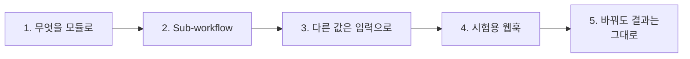
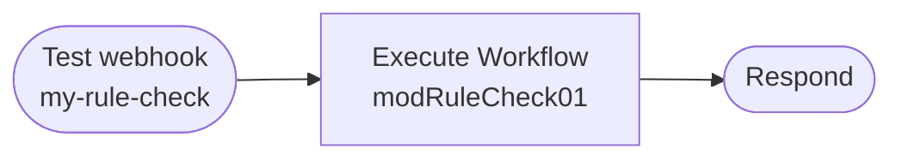

# 2단계 · 모듈화: Sub-workflow와 계약

- 교시: 3~4교시 (11:00~12:50)
- 실습: [Lab 02](../../Last3Mon/70/LAB-02-Q-MODULES.md)
- 이 단계가 끝나면: 여러 워크플로우가 쓰는 일을 n8n **Sub-workflow 모듈**로 떼어 내고, 따로 시험하고, 결과가 그대로인지 테스트로 확인하며 바꿀 수 있다.

## 1. 무엇을 모듈로

| 모듈 후보 | 아님 |
| --- | --- |
| **두 곳 이상**에서 쓴다 (공지, 문자) | 한 곳에서만 씀 |
| 입력과 결과를 **이름으로** 말할 수 있다 | 앞뒤 노드를 마음대로 읽어야 함 |
| 혼자 시험할 수 있다 | 전체를 돌려야만 확인됨 |
| 바뀌는 이유가 하나 (검사 규칙) | 여러 이유로 자주 바뀜 |

오늘의 모듈: **규칙 검사** (날짜·시간, 연락처, 길이, 꼭 넣을 문장). LLM이 없어 빠르고(0.1초), 공지 키트와 SMS가 함께 씁니다.

## 2. Sub-workflow

| 노드 | 하는 일 |
| --- | --- |
| Execute Workflow Trigger (모듈 쪽) | 모듈의 시작. **입력 이름과 종류**를 적는다 (`facts` 글자, `max_length` 숫자, `required_phrases` 목록) |
| Execute Workflow (부르는 쪽) | 모듈을 **id**로 찾아 입력을 넘기고, 모듈 마지막 노드의 결과를 받는다 |

| | 웹훅으로 부르기 (68·69일차) | Sub-workflow (오늘) |
| --- | --- | --- |
| 부르는 법 | HTTP POST `/webhook/<path>` | Execute Workflow, id |
| 계약이 보이는 곳 | 문서와 테스트 | Trigger 노드의 입력 목록 |
| 밖에서 바로 시험 | `call`로 바로 | 시험용 웹훅이 필요 |
| 꺼졌을 때 | 404 (68·69일차에서 다룸) | 모듈이 없으면 부르는 노드에서 실패 |

수업 준비 때 확인: n8n 2.42.6에서 웹훅이 없는(Trigger만 있는) 모듈도 `flow.py push`로 게시되고, 다른 워크플로우에서 id로 불러졌습니다. 모듈 파일에는 id(`modRuleCheck01`)를 **직접** 씁니다.

## 3. 다른 값은 입력으로

키트 안의 규칙 검사 코드는 웹훅 본문, 설정 표, 앞 노드를 바로 읽었습니다. 모듈은 그럴 수 없습니다 (부르는 쪽이 다르기 때문). 필요한 값을 모두 **입력**으로 받습니다.

| 입력 | 공지 키트가 주는 값 | SMS가 주는 값 |
| --- | --- | --- |
| `facts` | 웹훅 본문 | 웹훅 본문 |
| `draft` | 작성자 결과 | SMS 작성 결과 |
| `max_length` | 설정 표 (500~800) | 80 |
| `required_phrases` | 설정 표 | `[]` |

> 모듈 안에 "SMS면 80" 같은 **쓰는 곳 이야기**가 들어가면, 쓰는 곳이 늘 때마다 모듈을 고쳐야 합니다.

## 4. 시험용 웹훅

- 본문을 그대로 모듈 입력으로 넘기는 세 노드짜리 워크플로우. 모듈만 따로 `test` 할 수 있습니다.
- 수업 준비 때 `cases/lab02-module.json` 5/5. 처음 호출 1.6초, 그다음 0.1초씩.
- 일부러 틀린 초안(시간 빠짐, 전화번호, 꼭 넣을 문장 빠짐, 짧은 한도)을 넣어 **검사 코드 하나하나**를 확인합니다. 공지 전체를 돌려서는 이렇게 정확히 확인하기 어렵습니다.

## 5. 바꿔도 결과는 그대로 (리팩터링)

키트 안의 검사 코드를 지우고 모듈 호출로 바꿉니다. 바꾸기 전과 뒤에 **같은 테스트**를 돌립니다.

| 수업 준비 때 | `cases/lab01.json` |
| --- | --- |
| 바꾸기 전 (코드가 키트 안에) | 5/5 |
| 바꾼 뒤 (모듈 호출) | 5/5, 테스트 수정 없음 |
| SMS를 같은 모듈로 (`lab02-challenge`) | 4/4 |

- 테스트를 하나도 고치지 않고 통과해야 "결과는 그대로"입니다. 테스트를 고쳤다면 결과가 바뀐 것입니다.
- n8n **Executions**에는 키트 실행과 모듈 실행이 따로 남아, 어느 쪽에서 문제가 났는지 볼 수 있습니다.

## 정리

- [ ] 두 곳 이상에서 쓰고, 입력·결과를 이름으로 말할 수 있으면 모듈
- [ ] Execute Workflow Trigger에 입력 이름·종류, 부르는 쪽은 id로
- [ ] 쓰는 곳마다 다른 값은 모듈 안이 아니라 입력으로
- [ ] 시험용 웹훅으로 모듈만 따로, 바꾼 뒤에는 같은 테스트를 그대로
