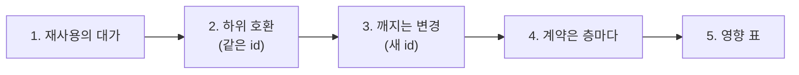
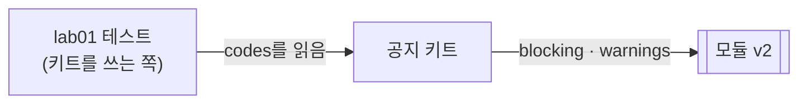

# 3단계 · 재사용 구조의 변경 관리

- 교시: 5~6교시 (14:00~15:50)
- 실습: [Lab 03](../../Last3Mon/70/LAB-03-Q-CHANGE-AND-VERSION.md)
- 이 단계가 끝나면: 여러 곳에서 쓰는 모듈을 바꿀 때 하위 호환인지 판단하고, 깨지는 변경은 새 버전으로 나란히 두며, 영향 받는 테스트를 모두 돌릴 수 있다.

## 1. 재사용의 대가

모듈을 한 번 고치면 쓰는 곳이 **모두 함께** 바뀝니다. 좋은 점(규칙 하나로 모두 고침)이자 위험(하나 고쳤는데 여럿이 깨짐)입니다.

| 질문 | 답에 따라 |
| --- | --- |
| 예전 호출이 아무것도 바꾸지 않아도 예전처럼 동작하나? | 예 → 하위 호환, **같은 id**로 고침 |
| 결과 필드가 없어지거나 뜻이 바뀌나? | 예 → 깨지는 변경, **새 id**로 새 버전 |

## 2. 하위 호환 변경: 사외 링크 금지

| 바꾼 것 | 하위 호환인 이유 |
| --- | --- |
| 새 입력 `allowed_domains` | 없으면 기본값 `intra.example.com` → 예전 호출은 고칠 필요 없음 |
| 새 코드 `external_link` | 기존 결과 필드(`passed`, `codes`, `issues`)는 그대로, `codes`에 하나 더 들어갈 뿐 |

수업 준비 때 (1회씩):

| 단계 | 결과 |
| --- | --- |
| 바꾸기 전 `lab03` | 3/4 (바깥 링크를 못 잡음) |
| 처음 고침: `new URL(...)`로 호스트 읽기 | 2/4 — **사내 링크까지 막음**. Code 노드 안에서 `URL`을 쓸 수 없어 모든 링크가 "읽기 실패 = 바깥"으로 처리됨 |
| 호스트를 글자로 잘라 읽기 | 4/4 |
| push 직후 쓰는 곳 | 모듈 시험 5/5 · 공지 키트 5/5 · SMS 4/4 |

> 같은 id로 push한 순간 키트와 SMS가 **모두** 새 모듈을 씁니다. 그래서 쓰는 곳 테스트를 모두 다시 돌립니다. 사내 링크까지 막혔던 버그가 그대로 나갔다면 공지와 문자가 함께 멈췄을 것입니다.

## 3. 깨지는 변경: 심각도

팀장: "글자 수 초과는 경고만, 나머지는 막기. 결과에 `blocking`과 `warnings`를." 문자는 지금 그대로.

| | v1.1 `modRuleCheck01` | v2 `modRuleCheck02` |
| --- | --- | --- |
| `passed` 뜻 | 문제가 하나도 없음 | **막는** 문제가 없음 (경고는 있어도 됨) |
| 결과 | `codes`, `issues` | `blocking`, `warnings`, `issues` |
| 쓰는 곳 | SMS, 시험용 웹훅 | 공지 키트, v2 시험용 웹훅 |

`passed`의 뜻과 결과 필드가 바뀌므로 같은 id로 고치면 SMS가 그 순간 깨집니다. 그래서 v2를 **나란히** 두고 키트만 옮겼습니다. 수업 준비 때 `cases/lab03-v2.json`(v2 모듈 · 키트 · SMS를 한 번에) 5/5.

## 4. 계약은 층마다

| 수업 준비 때 | `lab01` |
| --- | --- |
| 키트를 v2로 옮기며 결과를 `blocking`·`warnings`로 **바꾸고** `codes`를 뺌 | **2/5** |
| `codes`를 남기고(`blocking` + `warnings`) 새 필드를 **더함** | 5/5 |

> 모듈의 깨지는 변경을 새 id로 막아도, 중간 층(키트)이 그 변화를 **자기 계약**으로 흘려보내면 그 위가 깨집니다. 새 필드는 더하고, 예전 필드는 남깁니다.

## 5. 영향 표

모듈을 바꾸기 전에 "누가 쓰나"를 표로 만듭니다. 에이전트에게 `my-work/*.json`에서 `executeWorkflow`의 `workflowId`를 찾게 하면 빠릅니다 (확인은 사람이).

| 모듈 · 버전 | 쓰는 워크플로우 | 돌릴 테스트 |
| --- | --- | --- |
| `modRuleCheck01` (v1.1) | SMS, 시험용 웹훅 | `lab02-challenge`, `lab02-module`, `lab03` |
| `modRuleCheck02` (v2) | 공지 키트, v2 시험용 웹훅 | `lab01`, `lab01-challenge`, `lab03-v2` |

수업 준비 때 키트의 어려운 케이스 7개 (`kind`의 대소문자·공백, 한국어 이름, 공백만 보낸 사실, 없는 종류, 바깥·사내 링크, "아주 짧게"): 예제 2 키트 3/7 → 최종본 7/7. 고친 곳은 **키트만**(설정 표 앞에서 `kind` 다듬기, 사실 공백 확인, 없는 종류 처리)이었고 모듈은 고치지 않았습니다. 영향 표 덕분에 "키트 테스트만 돌리면 된다"는 것을 바로 알 수 있습니다.

## 정리

- [ ] 예전 호출이 그대로 동작하면 하위 호환 → 같은 id, 그리고 쓰는 곳 테스트를 **모두**
- [ ] 결과의 뜻·필드가 바뀌면 새 id로 나란히, 쓰는 곳을 하나씩 옮긴다
- [ ] 계약은 층마다: 중간 층도 예전 필드를 남기고 새 필드를 더한다
- [ ] 바꾸기 전에 영향 표: 누가 쓰고, 어떤 테스트를 돌릴지
