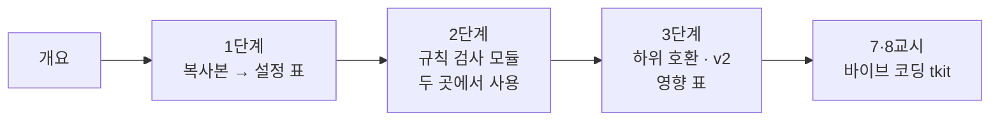

# 70일차 · Workflow 템플릿화와 모듈화, 재사용 가능한 구조 설계 (바이브 코딩)

- 일자: 2026-10-22 (70일차)
- 교과목: 노코드 멀티 에이전트 워크플로우 설계 및 운영
- 단원: 운영·확장 관점의 AI 워크플로우 설계 고도화
- 학습 내용: Workflow 템플릿화 및 모듈화, 재사용 가능한 구조 설계
- 실습 폴더: [Last3Mon/70](../../Last3Mon/70/README.md)
- 실습 환경: 65일차 n8n 2.42.6 + OpenAI API(`gpt-4.1-mini`) + **CLI 코딩 에이전트**(Codex · Claude Code · Antigravity 중 하나)
- **실습 준비: [00-DAY70-PREP.md](00-DAY70-PREP.md) (수업 전날까지 1~2절 완료)**

## 오늘의 시간표

| 교시 | 시간 | 내용 | 자료 |
| --- | --- | --- | --- |
| 1 | 09:00~09:50 | 오늘의 개요 · 1단계 · 템플릿화: 같은 것과 다른 것 나누기 | [개요](00-DAY70-OVERVIEW.md), [1단계](01-STAGE1-TEMPLATE.md) |
| 2 | 10:00~10:50 | 1단계 · Lab 01 (복사본 비교, 공지 키트, 과제: 새 종류 · 없는 종류) | [Lab 01](../../Last3Mon/70/LAB-01-Q-TEMPLATE-KIT.md) |
| 3 | 11:00~11:50 | 2단계 · 모듈화: Sub-workflow와 계약, Lab 02 예제 1·2 | [2단계](02-STAGE2-MODULES.md), [Lab 02](../../Last3Mon/70/LAB-02-Q-MODULES.md) |
| 4 | 12:00~12:50 | 2단계 · Lab 02 과제 35분 (SMS도 같은 모듈) · 풀이 | [Lab 02](../../Last3Mon/70/LAB-02-Q-MODULES.md) |
| - | 13:00~14:00 | 점심 |  |
| 5 | 14:00~14:50 | 3단계 · 재사용 구조의 변경 관리, Lab 03 예제 1·2 | [3단계](03-STAGE3-CHANGE-AND-VERSION.md), [Lab 03](../../Last3Mon/70/LAB-03-Q-CHANGE-AND-VERSION.md) |
| 6 | 15:00~15:50 | 3단계 · Lab 03 과제 40분 (영향 표 · 어려운 테스트) · 풀이 | [Lab 03](../../Last3Mon/70/LAB-03-Q-CHANGE-AND-VERSION.md) |
| 7 | 16:00~16:50 | 바이브 코딩 · `tkit` 만들기 (각자) | [VIBE-Q-TKIT](../../Last3Mon/70/VIBE-Q-TKIT.md), [진행](04-VIBE-CODING.md) |
| 8 | 17:00~17:50 | 바이브 코딩 발표 · 정리 · 강사 바이브 코딩 · 팁 · 71일차 예고 | [진행](04-VIBE-CODING.md) |

## 자료 목록

| 파일 | 내용 |
| --- | --- |
| `00-DAY70-PREP.md` | 실습 준비: n8n 켜기, `flow.py doctor` (수업 전) |
| `00-DAY70-OVERVIEW.md` | 개요 13장 (PPT 대신 Markdown, 가로줄로 장 구분) |
| `01-STAGE1-TEMPLATE.md` | 복사의 비용, 같은 것·다른 것·우연히 다른 것, 설정 표, 없는 값은 멈춤 |
| `02-STAGE2-MODULES.md` | 모듈의 조건, Sub-workflow(Execute Workflow · Trigger), 입력으로 받기, 시험용 웹훅, 리팩터링 |
| `03-STAGE3-CHANGE-AND-VERSION.md` | 하위 호환 변경, 깨지는 변경과 새 버전, 계약은 층마다, 영향 표 |
| `04-VIBE-CODING.md` | 7·8교시 바이브 코딩 진행 (tkit), 발표, 강사 정리, 추가 바이브 코딩, 팁 |
