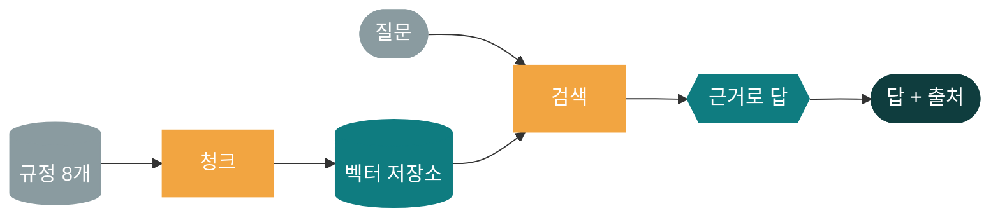
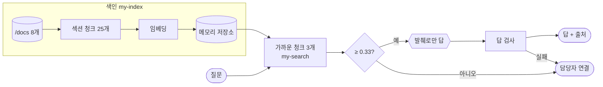
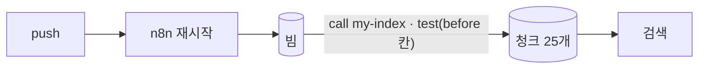
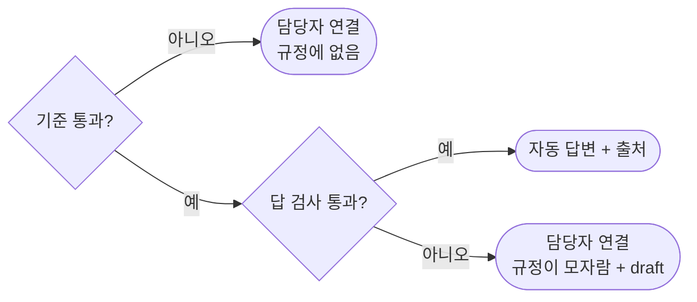

# 71일차 개요 · RAG 기반 검색·응답과 검색 품질 개선

> 운영·확장 관점의 AI 워크플로우 설계 고도화 · 2026-10-23
> 23장 · 각 장은 가로줄(`---`)로 나뉩니다. 1교시에는 1~7장을 보고, 나머지 장은 각 단계를 설명할 때 함께 띄웁니다.
> 숫자는 2026-10-18 수업 준비 측정과 2026-10-22 같은 정답으로 다시 돌린 기록입니다.

| 장 | 범위 |
| --- | --- |
| 1~7 | 표지 · 목표 · 시간표 · 앞 일차와의 연결 · 왜 RAG인가 · 오늘의 그림 · 오늘의 문서 |
| 8~11 | 1단계 · 점수 읽기 · 정답표 · 청크 하나 · 메모리 저장소 |
| 12~16 | 2단계 · 발췌로만 · 출처 · 관련도 기준 · 답이 없을 때 · 넘기는 길 |
| 17~21 | 3단계 · 지표 셋 · 청크 크기 · 잘린 문장과 섞인 청크 · 질문 다시 쓰기 · 같은 설정 다른 결과 |
| 22~23 | 7교시 바이브 코딩 · 정리와 예고 |

---

## 1 / 23 · 표지



**71일차**

# RAG 기반 검색·응답과 검색 품질 개선

정답표 · 청크 · 임베딩 · 근거로 답하기 · 답 검사 · doc@1 · answer@1

<sub>운영·확장 관점의 AI 워크플로우 설계 고도화 · 2026-10-23</sub>

---

## 2 / 23 · 오늘 할 수 있게 될 세 가지

| | 오늘 할 수 있게 될 것 |
| :-: | --- |
| **①** | 검색 전에 **정답표**를 만들고, 규정 문서를 색인·검색하는 워크플로우를 요청문으로 만든다 |
| **②** | 검색한 발췌로만 답하고 출처를 붙이며, 관련 없거나 답이 없으면 **넘긴다** |
| **③** | 검색 품질을 **숫자**(doc@1 · answer@1 · answer@3)로 재고, 한 번에 하나씩 바꿔 고친다 |

---

## 3 / 23 · 오늘의 시간표

| ① 1~2교시 | ② 3~4교시 | ③ 5~6교시 | ④ 7~8교시 |
| --- | --- | --- | --- |
| **1단계** | **2단계** | **3단계** | **바이브 코딩** |
| RAG와 색인 | 근거로 답하기 | 검색 품질 | `tdoc` |
| Lab 01 정답표 · 색인 · 검색 | Lab 02 출처 · 기준값 · 답 검사 | Lab 03 재기 · 고치기 | 요청서 → SPEC → 만들기 · 발표 |

> 09:00 시작 · 50분 수업 10분 휴식 · 4교시 뒤 13:00~14:00 점심

---

## 4 / 23 · 앞 일차와의 연결

| 일차 | 그때 | 오늘 이어지는 것 |
| --- | --- | --- |
| 64 | 지시문에 규칙을 적음 | "발췌로만, 번호로, 모르면 이 문장" |
| 67 | FAQ Tool (**낱말**로 찾기), Check answer | 뜻으로 찾기, 답 검사 넷 |
| 69 | 검토 답을 못 읽으면 통과로 치지 않음 | 확실하지 않으면 담당자 연결 |
| 70 | 계약을 정하고 테스트로 지킴 | 색인 · 검색 · Q&A 계약, 24문항 |
| 72 (내일) | 느린 곳 재기 | LLM 없는 길 0.3초 vs LLM 1.8~3.0초 |

---

## 5 / 23 · 왜 RAG인가

| | LLM에 그냥 묻기 | RAG |
| --- | --- | --- |
| "비밀번호 며칠마다?" | 그럴듯한 숫자 | 우리 규정의 **90일** + `[비밀번호·계정 보안 규정]` |
| 규정이 바뀌면 | 모델이 모름 | 문서만 다시 색인 |
| 틀렸는지 확인 | 어려움 | 출처를 열어 봄, 코드로 검사 |

| 다른 방법 | 왜 오늘은 아닌가 |
| --- | --- |
| 지시문에 규정 전부 | 문서가 많으면 길고, 바뀔 때마다 지시문을 고침 |
| 파인튜닝 | 사실을 정확히 외우게 하기 어렵고 출처가 없음 |
| Tool로 조회 (67일차) | 낱말이 맞아야 찾음 ("암호" ≠ "비밀번호") |

---

## 6 / 23 · 오늘의 그림



> 메모리 저장소는 n8n이 재시작되면(push 할 때마다) 지워집니다. `flow.py test`는 케이스 파일의 `before` 칸(명령이 아님)에 적힌 대로 먼저 색인합니다.

---

## 7 / 23 · 오늘의 문서 · 규정 8개, 섹션 25개

| 문서 | 섹션 | 문서 | 섹션 |
| --- | --- | --- | --- |
| 비밀번호·계정 보안 | 4 | 개인정보 처리 지침 | 3 |
| 업무용 장비 지급·반납 | 4 | 원격근무·VPN 이용 | 3 |
| 메일·문서 보안 | 3 | 보안 사고 대응 절차 | 2 |
| 회의실 이용 | 3 | 소프트웨어 사용 | 3 |

> 문서 하나가 526~928바이트로 짧고, 모두 `## ` 섹션으로 나뉩니다. 데이터 API `/docs`(71일차 판)에서 가져옵니다.

---

## 8 / 23 · 1단계 · 점수 읽기 (섹션 청크, 실측)

| 질문 | 1등 | 2등 | 3등 |
| --- | --- | --- | --- |
| 비밀번호는 몇 자 이상? | 만들기 **0.748** | 변경 주기 0.54 | 잠금 0.484 |
| 암호를 얼마나 자주 바꿔야 해? | 변경 주기 **0.576** | 만들기 0.512 | 다단계 인증 0.456 |
| 컴퓨터가 바이러스에 걸린 것 같아요 | 악성코드 **0.478** | 피싱 0.357 | 재택 보안 0.249 |
| 오늘 점심 메뉴 추천해줘 | (규정 아무거나) **0.202** | | |

> "암호"는 규정에 없는 낱말인데 "변경 주기"가 1등 → **뜻**으로 찾았습니다. 점수는 확률이 아니라 **순서**의 근거입니다.

---

## 9 / 23 · 1단계 · 정답표가 먼저

| 질문 | 문서 | 답 문구 |
| --- | --- | --- |
| 비밀번호는 몇 자 이상? | `password-policy` | 12자 |
| 암호를 얼마나 자주 바꿔야 해? | `password-policy` | 90일 |
| 회사를 그만두면 노트북은? | `device-issue-return` | 5영업일 |
| 연차 휴가는 며칠? | **없음** | — |

> 검색 결과를 보고 "그럴듯하다"고 판단하지 않습니다. 먼저 정답을 정해야 **셀 수** 있습니다. 정답표도 틀립니다: "윈도우 업데이트"는 규정에 없었습니다.

---

## 10 / 23 · 1단계 · 청크 하나의 모양

```text
글:        비밀번호·계정 보안 규정            ← 문서 제목을 앞에
           ## 2. 변경 주기
           - 비밀번호는 90일마다 바꾼다. …
메타데이터: source · title (과제: section)     ← 출처는 여기서
벡터:      3,072차원 (text-embedding-3-large)
```

| | 결과 (실측) |
| --- | --- |
| `lab01` | 6/6 |
| 섹션 제목까지 출처 (`lab01-challenge`) | 예제 2/4 → 4/4 |

> 예제는 섹션 제목이 **글 안에는** 있지만 **칸으로는** 없어서 2/4였습니다.

---

## 11 / 23 · 1단계 · 메모리 저장소의 한살이



| | 시간 (실측) |
| --- | --- |
| push 직후 첫 색인 | 3.8초 |
| 다시 색인 (`test`가 `before` 칸으로) | 0.4~2.2초 |
| 검색 한 번 | 0.2~0.9초 |

> 운영에서는 n8n 밖의 벡터 DB(재시작에도 남음, 바뀐 문서만 다시 색인). 흐름은 같습니다.

---

## 12 / 23 · 2단계 · 발췌로만 답하기

```text
질문: 암호를 얼마나 자주 바꿔야 해?
규정 발췌:
[1] 비밀번호·계정 보안 규정 ## 2. 변경 주기 - 비밀번호는 90일마다 바꾼다. …
[2] … ## 1. 비밀번호 만들기 …
[3] … ## 4. 다단계 인증 …
```

→ "암호는 90일마다 변경해야 하며, … [비밀번호·계정 보안 규정]" (`lab02` 6/6)

> 틀린 전제("30일마다 바꾸면 되죠?")에도 "30일이 아니라 90일"이라고 답했습니다. 질문이 아니라 **발췌**가 기준입니다.

---

## 13 / 23 · 2단계 · 번호로 출처, `sources`와 `cited`

| 질문 | `sources` (찾은 문서) | `cited` (인용한 문서) |
| --- | --- | --- |
| 생성형 AI에 고객 자료를 넣어도? | 소프트웨어, 개인정보 | 소프트웨어 |
| 비밀번호를 잊어버리면 어디서 바꿔요? | 비밀번호 | **없음** |

> LLM은 `[번호]`만 쓰고, 번호 → 제목은 **코드**가 바꿉니다. 찾았는데 인용하지 않았다면 답이 발췌를 쓰지 않은 것입니다.

---

## 14 / 23 · 2단계 · 관련도 기준 0.33

| 규정 질문 5개 | 규정 밖 5개 (점심 · 연차 · 영화 · 맛집 · 연봉) |
| --- | --- |
| 0.464 ~ 0.616 | 0.202 ~ 0.261 |

| 기준을 올리면 | 기준을 낮추면 |
| --- | --- |
| 진짜 질문도 넘김 (0.47 → "퇴사 노트북" 0.464) | 엉뚱한 질문에 답을 씀 |

> 답이 **있는데** 0.267인 질문도 있습니다 ("공짜 프로그램은 그냥 써도 되죠?"). 기준값은 모델마다 두 무리를 재서 정합니다.

---

## 15 / 23 · 2단계 · 점수는 높은데 답이 없을 때

| 질문 | 점수 | 기준값만 쓴 결과 |
| --- | --- | --- |
| VPN 접속 속도가 느리면? | 0.463 | `자동 답변`: "…언급하고 있지 않습니다" |
| 노트북 사양은? | 0.379 | `자동 답변`: "…포함되어 있지 않습니다" + **출처 3개** |
| 비밀번호를 잊어버리면? | 0.551 | `자동 답변`: "규정에서 답을 찾지 못했습니다" |

> 기준값으로는 못 거릅니다. **답 검사**(모른다고 했나 · 인용 · 근거 겹침 · 숫자)로 넘깁니다: `lab02-challenge` 2/8 → 8/8 (`--repeat 3` 24/24).

---

## 16 / 23 · 2단계 · 넘기는 길 세 갈래



> 두 담당자 연결은 **말과 넘기는 것이 다릅니다.** 뒤쪽이 쌓이는 곳(VPN 속도, 노트북 사양 …)이 규정을 보완할 곳입니다.

---

## 17 / 23 · 3단계 · 지표 셋

| 지표 | 묻는 것 |
| --- | --- |
| doc@1 | 1등이 맞는 **문서**인가 |
| answer@1 | 1등에 **답 문구**가 있나 |
| answer@3 | 3등 안에 답 문구가 있나 (LLM에 3개를 줌) |

| answer@1에서 틀린 예 | 1등 (답 없음) | 2등 (답 있음) |
| --- | --- | --- |
| 회사를 그만두면 노트북은? | 지급과 교체 0.464 | 반납 0.45 |

> doc@1 ✔ · answer@1 ✘ = 맞는 문서의 **다른 섹션**이 1등.

---

## 18 / 23 · 3단계 · 청크 크기 (24문항)

| 설정 | 청크 | doc@1 | answer@1 | answer@3 |
| --- | --- | --- | --- | --- |
| 섹션 | 25 | 24 | 22 | 24 |
| 200자 | 20 | 24 | 20 | 24 |
| 400자 | 12 | 22 | 22 | 24 |

> 한 번에 **하나만** 바꿉니다. `call my-index` + `test --no-before`. 우리 문서에서는 섹션이 가장 좋았고, 3개를 주면(answer@3) 차이가 줄었습니다.

---

## 19 / 23 · 3단계 · 잘린 문장과 섞인 청크

| 설정 | 일어난 일 |
| --- | --- |
| 200자 | "만료 **30일 전부터** … 새 인증서를 \| 신청한다" — 문장 한가운데가 잘려 답 문구가 앞 청크로. 섹션 이름도 어긋남 |
| 400자 | 원격근무 문서의 섹션 셋이 모두 한 청크에 → "화면 잠금" 질문의 1등이 **0.241** 회의실 규정, 답이 든 청크는 2등 0.236 (섹션 색인에서는 0.354로 1등) |

> 같은 22점이라도 **틀린 질문이 다릅니다.** 표에 틀린 질문까지 적습니다.

---

## 20 / 23 · 3단계 · 질문 다시 쓰기의 득실

| 질문 | 다시 쓴 검색어 | 결과 |
| --- | --- | --- |
| 챗GPT에 회의록 붙여 넣어도 돼요? | 생성형 AI 서비스에 회의록 데이터 입력 정책 | ✘ 회의실 → ✔ 소프트웨어 |
| 고객 명단 엑셀을 개인 메일로 … | 고객 명단 엑셀 외부로 보내기 및 보안 정책 | ✘ 보안 사고 → ✔ 메일·문서 |
| 모르는 프로그램이 자꾸 저절로 떠요 | 알 수 없는 프로그램 자동 실행 정책 | ✔ 보안 사고 → ✘ **소프트웨어** |

| | 다시 쓰기 없이 | 다시 쓰기 |
| --- | --- | --- |
| 어려운 질문 8개 | 6/8 | 7/8 |
| 검색 시간 | 0.2~0.5초 | 0.9~2.0초 |

> 고치면 다른 것이 깨질 수 있습니다. 좋아진 것과 나빠진 것을 **함께** 잽니다.

---

## 21 / 23 · 3단계 · 같은 설정, 다른 결과

| | 10/18 | 10/22 |
| --- | --- | --- |
| "고객 정보가 밖으로 샌 것 같아요" 다시 쓴 검색어 | 유출 **대응 방안** | 유출 **방지 정책** |
| 1등 | 3. 유출 대응 ✔ | 2. 이용과 보관 ✘ |
| 24문항 answer@1 | 24 | 23 |

> 검색 앞에 LLM이 있으면 검색도 매번 달라집니다. `--repeat`으로 재고 **범위**로 적습니다. LLM이 없는 섹션 검색은 두 날 모두 22였습니다.

---

## 22 / 23 · 7교시 · 바이브 코딩 `tdoc`

```text
$ tdoc ~/aio-01d4-stu/Lecture
질문: [메모리 저장소는 언제 지워져요?]
답: n8n이 재시작되면 지워집니다 [1] …
근거: [1] 0.xx Lecture/71/01-STAGE1-RAG-AND-INDEX.md · 5. 메모리 저장소
```

- **요청서(`VIBE-REQ-TDOC`)부터** 읽고 `SPEC.md`를 에이전트 없이 10분 → VIBE-Q와 비교 → 단계별로 만들기
- 내 md 문서를 SQLite에 색인(바뀐 파일만)하고 근거와 함께 답하는 TUI, 설정 비교(`tdoc eval`)

---

## 23 / 23 · 정리와 72일차 예고

| 오늘 | 한 줄 |
| --- | --- |
| 1단계 | 정답표가 먼저, 청크는 뜻 단위로, 메타데이터가 출처, 메모리 저장소는 재시작에 지워짐 |
| 2단계 | 발췌로만 답하고 번호로 출처, 기준값은 엉뚱한 질문을, 답 검사는 답 없는 질문을 |
| 3단계 | 지표 셋으로 재고, 하나씩 바꾸고, 틀린 질문과 나빠진 것도 적는다 |

- 72일차: **Workflow 실행 흐름 최적화** — 느린 곳을 재고, 규칙 먼저·캐시·LLM 호출 줄이기로 빠르게, 고장 나도 정해진 답을 · 바이브 코딩 `tbench`
