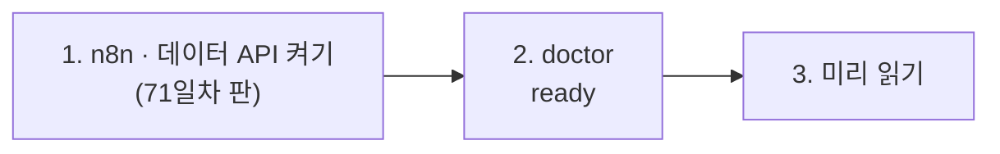

# 71일차 실습 준비 · 수업 전에 미리 해 두면 좋은 것

- 수업일: 2026-10-23 (71일차) · RAG 기반 검색·응답 Workflow와 검색 품질 개선
- 준비 시간: 약 10분 (70일차 준비를 했다면 1·2절만)
- 먼저 WSL에서 `cd ~/aio-01d4-stu && git pull`로 오늘 자료를 받습니다 (수강생 저장소: https://gl.isitsoft.kr/publicproj/aio-01d4-stu).
- **수업 전날까지** 1~2절을 끝내 주세요.



---

## 1. n8n과 데이터 API 켜기 (전날 필수, 3분)

오늘은 **71일차 판 데이터 API**(67일차 + 규정 문서 `/docs`)를 씁니다. 67일차 데이터 API를 켜 두었다면 이 폴더에서 다시 만들면 바뀝니다 (같은 이름이라 하나만 돕니다).

```bash
sudo systemctl disable --now ollama 2>/dev/null   # WSL에 설치한 Ollama가 있으면 끄고 자동 시작도 끔
cd ~/aio-01d4-stu/Last3Mon/65/n8n
docker compose rm -sf ollama                      # Ollama 컨테이너가 있으면 지움 (없으면 그냥 지나감)
docker compose start
cd ~/aio-01d4-stu/Last3Mon/71/data-api
docker compose up -d --force-recreate
curl -s localhost:8800/docs | head -c 120    # {"docs": [{"name": "device-issue-return", ...
```

- **66일차부터 LLM은 OpenAI API 키(`Last3Mon/.env`, Credential `OpenAI (.env)`)만 씁니다.** Ollama는 쓰지 않으므로 위처럼 꺼서 메모리를 아낍니다. 다음 날부터는 같은 명령을 그대로 써도 됩니다.
- `network day65-n8n_default not found` → n8n이 켜져 있지 않음. 위 n8n 부분부터 다시.
- `.../day65-n8n/compose.yml: no such file or directory` → 홈이 아닌 곳에 설치함. `Last3Mon/65/n8n/.env`에 `N8N_HOME=<설치 폴더>` ([67일차 준비](../67/00-DAY67-PREP.md) 1절).

## 2. 준비 확인 (전날 필수, 2분)

```bash
cd ~/aio-01d4-stu/Last3Mon/71
uv run tools/flow.py doctor
```

```text
✔ n8n install folder /home/<사용자>/day65-n8n
✔ n8n container day65-n8n-n8n-1
✔ n8n http://localhost:5678
✔ data API http://localhost:8800
✔ policy documents /docs (8)
✔ n8n → http://data-api:8800
✔ credential 'OpenAI (.env)' (openAiCourse0001)
✔ node catalog (for check)
✔ CLI coding agent: codex, claude
ready
```

| ✘ 항목 | 할 일 |
| --- | --- |
| n8n container · data API | 1절 |
| policy documents /docs | 데이터 API가 예전 판 → 1절 `--force-recreate` |
| credential | `cd ~/aio-01d4-stu/Last3Mon/65/n8n && bash register-credentials.sh` |
| CLI coding agent | [67일차 준비](../67/00-DAY67-PREP.md) 2절 |

---

## 3. 미리 읽어 오면 좋은 내용 (선택, 약 5분)

### 3.1 LLM은 우리 회사 규정을 모른다

"비밀번호는 며칠마다 바꿔야 하나요?"를 LLM에게 그냥 물으면 그럴듯한 숫자를 말합니다. 우리 규정(90일)을 답하게 하려면, 질문할 때마다 **규정에서 관련 부분을 찾아** LLM에게 같이 주어야 합니다. 이것이 RAG입니다.

### 3.2 용어

| 용어 | 한 줄 설명 |
| --- | --- |
| RAG | 검색(Retrieval)한 문서를 붙여(Augmented) 답을 만든다(Generation) |
| 청크 | 문서를 검색 단위로 나눈 조각 (오늘은 섹션 하나) |
| 임베딩 | 글의 뜻을 숫자 목록(벡터)으로 바꾼 것. 뜻이 가까우면 숫자도 가깝다 |
| 벡터 저장소 | 청크와 그 임베딩을 저장하고 가까운 것을 찾아 주는 곳 (오늘은 n8n 메모리) |
| doc@1 · answer@1 | 1등 청크가 맞는 문서인가 · 답 문구를 담고 있나 (검색 품질 지표) |

## 4. 당일 준비물

- 충전된 노트북과 충전기, WSL의 Docker, Windows Terminal(WSL) 창 **두 개**, 웹 브라우저
- 7교시 `tdoc`에 쓸 내 md 문서 폴더 (없으면 이 과정의 `Lecture/` 폴더를 씀)

## 확인

- [ ] `curl -s localhost:8800/docs`에 규정 8개가 보인다
- [ ] `uv run tools/flow.py doctor` → 마지막 줄 `ready`
