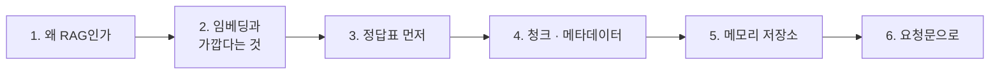
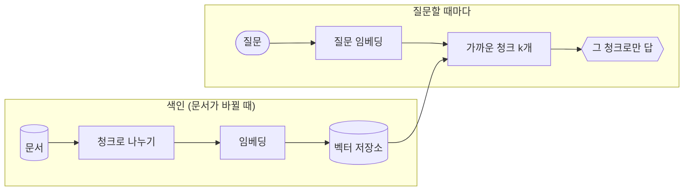
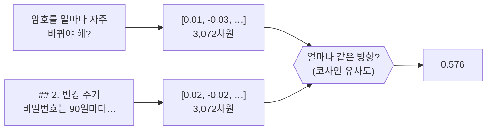
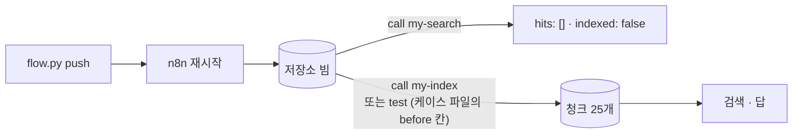

# 1단계 · RAG와 색인

- 교시: 1~2교시 (09:00~10:50) · 1교시 강의(개요 포함) 약 40분, 2교시 Lab 01
- 실습: [Lab 01](../../Last3Mon/71/LAB-01-Q-INDEX-AND-SEARCH.md)
- 이 단계가 끝나면: RAG의 두 흐름(색인 · 질문)을 설명하고, 검색 전에 정답표를 만들고, 규정 문서를 색인·검색하는 n8n 워크플로우를 요청문으로 만들 수 있다.
- 이 교안의 숫자: 2026-10-18 수업 준비 측정, 2026-10-22 같은 정답으로 다시 돌린 기록([Last3Mon/71/answers](../../Last3Mon/71/answers/LAB-TEST-RESULT.md), 수업 뒤 공개)



| 절 | 말하는 시간 (예) | 띄울 것 |
| --- | --- | --- |
| 1. 왜 RAG인가 | 7분 | 1절 표 · 그림 |
| 2. 임베딩과 가깝다는 것 | 8분 | 실측 점수 표 |
| 3. 정답표 먼저 | 7분 | 정답표 · 질문 종류 |
| 4. 청크 · 메타데이터 | 8분 | 규정 8개 표 · 청크 하나 |
| 5. 메모리 저장소 | 5분 | 한살이 그림 |
| 6. 요청문으로 · 확인 질문 | 5분 | 요청문 예 |

## 1. 왜 RAG인가

### 1.1 LLM이 우리 회사 일을 못 하는 세 가지 까닭

| 까닭 | 예 | 결과 |
| --- | --- | --- |
| **모른다** | 우리 회사 비밀번호 규정은 학습한 적이 없음 | "보통 90일입니다"처럼 **그럴듯한 일반론** |
| **오래됐다** | 규정이 지난주에 바뀜 | 바뀐 것을 모름. 모델을 다시 학습시킬 수도 없음 |
| **출처가 없다** | 답이 맞는지 사람이 확인할 곳이 없음 | 틀려도 모름 (가장 위험) |

LLM은 우리 회사 규정을 모릅니다. "비밀번호는 며칠마다 바꿔요?"에 그럴듯한 숫자를 말할 뿐입니다. 그 숫자가 우연히 맞아도, **왜 맞는지**를 보여 줄 수 없습니다.

### 1.2 우리 문서를 LLM에게 알려 주는 네 가지 방법

| 방법 | 어떻게 | 좋은 점 | 한계 | 이 과정에서 |
| --- | --- | --- | --- | --- |
| 지시문에 모두 넣기 | 규정 전문을 system 메시지에 | 가장 쉬움 | 문서가 많으면 길어지고(비용 · 시간), 바뀔 때마다 지시문을 고침 | 64일차 공지 지시문 |
| 파인튜닝 | 우리 문서로 모델을 더 학습 | 말투 · 형식에 강함 | 사실을 정확히 외우게 하기 어렵고, 바뀔 때마다 다시 학습, 출처 없음 | 하지 않음 |
| Tool로 조회 | LLM이 "FAQ 찾기" Tool을 부름 | 정해진 질의(번호 · 이름)에 정확 | 낱말이 맞아야 찾음 | 67일차 FAQ Tool |
| **RAG** | 질문할 때마다 문서에서 **관련 부분만 찾아** 함께 줌 | 문서가 바뀌면 다시 색인만, **출처**가 남음 | 찾는 것이 틀리면 답도 틀림 | **오늘** |

**RAG**(Retrieval-Augmented Generation, 검색 증강 생성)는 질문할 때마다 규정에서 **관련 부분만 찾아** LLM에게 같이 주고, 그 부분으로만 답하게 합니다. 이름 그대로 **검색(Retrieval)이 생성(Generation)을 돕습니다.**



- 색인은 **가끔**(문서가 바뀔 때), 질문은 **매번**. 두 흐름은 다른 워크플로우입니다 (오늘 `my-index`, `my-search`).
- 오늘 1단계는 **찾기까지**만 합니다. 답을 쓰는 것은 2단계입니다. 찾는 것이 틀리면 아무리 좋은 LLM도 맞는 답을 쓸 수 없기 때문에, 찾기를 따로 재고 확인합니다.

### 1.3 67일차 FAQ 검색과 무엇이 다른가

| | 67일차 FAQ 검색 | 오늘 RAG |
| --- | --- | --- |
| 찾는 법 | 낱말이 겹치나 (`keywords`) | **뜻**이 가까운가 (임베딩) |
| "암호를 바꿔야 해?" | "암호"가 키워드에 없으면 못 찾음 | "비밀번호" 섹션을 찾음 (실측 아래 2절) |
| 찾는 단위 | FAQ 한 개 | 문서의 한 섹션 (청크) |
| 준비 | 사람이 FAQ마다 키워드를 적음 | 문서를 그대로 색인 |
| 틀리는 방식 | 못 찾음 (0개) | **언제나 무언가를 찾음** (엉뚱한 것도) |

마지막 줄이 오늘 하루의 숙제입니다. 낱말 검색은 못 찾으면 "없음"이라고 하지만, 뜻 검색은 점심 메뉴를 물어도 가장 가까운 규정 3개를 돌려줍니다. 2단계의 관련도 기준과 답 검사가 이것 때문에 필요합니다.

## 2. 임베딩과 "가깝다"는 것

### 2.1 임베딩은 글을 숫자 목록으로

**임베딩**은 글 한 덩어리를 숫자 목록(벡터) 하나로 바꾸는 것입니다. 오늘 쓰는 `text-embedding-3-large`는 글 하나를 **3,072차원** 벡터(숫자 3,072개짜리 목록)로 바꿉니다 (모델 기본값). 뜻이 비슷한 글은 비슷한 숫자 목록이 되도록 학습된 모델입니다.



- 숫자 하나하나에 뜻이 있는 것은 아닙니다. **두 목록이 얼마나 같은 방향을 가리키는지**(코사인 유사도)만 씁니다. 그림의 숫자 목록은 모양을 보여 주는 예이고, 0.576은 실제로 잰 점수입니다.

### 2.2 왜 3,072차원인가

3,072차원은 벡터가 숫자 몇 개로 되어 있는지(**차원 수**)입니다. 글이 섹션 하나든 질문 한 줄이든, 이 모델은 늘 3,072차원 벡터 하나를 돌려줍니다.

| 물음 | 답 |
| --- | --- |
| 왜 하필 3,072차원? | 데이터에서 나온 값이 아니라 **모델을 만들 때 정한 크기**입니다. 같은 회사의 작은 모델 `text-embedding-3-small`은 1,536차원. 많을수록 뜻의 미묘한 차이를 더 담을 수 있지만, 저장 공간과 계산이 늘어납니다 |
| 숫자 하나는 무슨 뜻? | 3,072차원 공간의 **좌표**입니다. 지도에서 (위도, 경도) 두 숫자로 위치를 나타내듯, 글 하나를 3,072차원 공간의 한 점으로 나타냅니다. 다만 각 축에 사람이 읽을 뜻("3번째 = 보안 정도")은 없습니다. 모델이 학습하며 스스로 정한 축입니다 |
| 질문과 청크를 다른 모델로? | 안 됩니다. 차원 수가 다르면 비교가 안 되고, 같아도 모델이 다르면 공간이 달라 점수가 의미 없습니다. **모델을 바꾸면 전부 다시 색인**하고 관련도 기준값도 다시 잽니다 |
| 저장 크기는? | 숫자 하나를 보통 4바이트로 저장하면 청크 하나에 약 12KB. 오늘 섹션 청크 25개면 약 300KB로 작지만, 수십만 청크면 GB 단위가 됩니다. 7교시 `tdoc`이 SQLite에 저장하는 것이 이 숫자 목록입니다 |
| 줄일 수 있나? | text-embedding-3 모델은 요청할 때 `dimensions`(예: 256, 1024)로 더 짧은 벡터를 받을 수 있습니다. 가볍고 빠르지만 품질이 조금 떨어질 수 있습니다 (오늘은 쓰지 않았고 재지도 않음) |
- n8n의 메모리 저장소는 이 점수를 0~1로 돌려줍니다. 클수록 가깝습니다.

### 2.3 실제로 잰 점수 읽기 (섹션 청크 25개, 2026-10-22)

| 질문 | 1등 | 2등 | 3등 |
| --- | --- | --- | --- |
| 비밀번호는 몇 자 이상이어야 하나요? | 비밀번호 · 1. 만들기 **0.748** | 비밀번호 · 2. 변경 주기 0.54 | 비밀번호 · 3. 잠금 0.484 |
| 암호를 얼마나 자주 바꿔야 해? | 비밀번호 · 2. 변경 주기 **0.576** | 비밀번호 · 1. 만들기 0.512 | 비밀번호 · 4. 다단계 인증 0.456 |
| 첨부 파일이 너무 커서 메일이 안 보내져요 | 메일 · 2. 첨부 파일 **0.616** | 메일 · 1. 메일함 0.455 | 보안 사고 · 1. 피싱 메일 0.335 |
| 컴퓨터가 바이러스에 걸린 것 같아요 | 보안 사고 · 2. 악성코드 **0.478** | 보안 사고 · 1. 피싱 0.357 | 원격근무 · 3. 재택 보안 0.249 |

`top_k: 5`로 같은 바이러스 질문을 물으면 4등 0.246(비밀번호 · 잠금), 5등 0.241(소프트웨어 · 설치)이 더 나옵니다.

읽는 법:

1. **"암호"는 규정에 없는 낱말**입니다 (규정은 "비밀번호"). 그래도 1등이 "2. 변경 주기"입니다 → 뜻으로 찾았습니다.
2. 점수는 **확률이나 퍼센트가 아닙니다.** 0.478은 "47.8% 맞음"이 아니라, 같은 질문의 다른 청크보다 가깝다는 **순서**의 근거입니다. 질문마다 1등 점수가 0.478~0.748로 다릅니다.
3. 1등과 2등의 **차이**도 봅니다. 바이러스 질문은 1등 0.478, 2등 0.357 → 1등이 뚜렷합니다. 3등 이하는 0.25 근처로 모두 비슷합니다 → "관련 없는 것들의 점수대"입니다.
4. 점심 메뉴처럼 규정과 상관없는 질문의 1등은 0.202였습니다. 이 "관련 없는 점수대"를 2단계에서 기준값으로 씁니다.

### 2.4 같은 질문인데 점수가 조금 다르다

같은 질문 "비밀번호를 잊어버리면 어디서 바꿔요?"의 1등 점수가 한 실행에서는 0.551, 다른 실행에서는 0.55였습니다 ("보안 교육" 질문도 0.352와 0.353). 임베딩도 셋째 자리에서 조금씩 흔들립니다. 그래서 기준값을 어떤 질문의 점수 바로 옆(예: "보안 교육"이 0.352~0.353이니 0.353)에 두지 않습니다. 그러면 같은 질문이 실행마다 통과했다 걸렸다 합니다. 두 무리 사이 **한가운데**에 여유 있게 둡니다 (오늘 0.33: 규정 밖 최고 0.261, 규정 질문 최저 0.464, 2단계 3절).

## 3. 정답표가 먼저

### 3.1 검색을 만들기 전에 사람이 정답을 정한다

| 질문 | 답이 있는 문서 | 섹션 | 답 문구 |
| --- | --- | --- | --- |
| 비밀번호는 몇 자 이상이어야 하나요? | `password-policy` | 1. 비밀번호 만들기 | 12자 |
| 암호를 얼마나 자주 바꿔야 해? | `password-policy` | 2. 변경 주기 | 90일 |
| 회사를 그만두면 노트북은 언제까지 돌려줘야 하나요? | `device-issue-return` | 3. 반납 | 5영업일 |
| 연차 휴가는 며칠이에요? | **없음** | — | — |

- 정답표가 있어야 검색이 맞았는지 **숫자로** 셉니다 (3단계에서 24문항).
- 답이 **없는** 질문도 정답표에 넣습니다. 검색은 언제나 무언가를 돌려주기 때문입니다 (1.3절 마지막 줄).
- 정답표 없이 검색 결과를 보면, 나온 것이 그럴듯해 보여서 "잘 되네요"가 됩니다. **결과를 보기 전에** 써야 합니다.

### 3.2 질문을 고르는 법: 네 종류를 섞는다

| 종류 | 예 | 무엇을 시험하나 |
| --- | --- | --- |
| 규정 낱말 그대로 | 비밀번호는 몇 자 이상? | 기본이 되는가 |
| 직원 말투 · 다른 낱말 | 암호를 얼마나 자주 바꿔야 해? / 회사를 그만두면 | 뜻으로 찾는가 |
| 규정에 답이 없음 | 연차 휴가는 며칠? / 노트북 사양은? | 모를 때 넘기는가 (2단계) |
| 틀린 전제 | 비밀번호는 30일마다 바꾸면 되죠? | 질문이 아니라 규정을 따르는가 (2단계) |

오늘 Lab의 24문항(`cases/retrieval-*.json`)은 규정 8개에서 2~4개씩, 낱말 그대로와 다른 낱말을 섞어 만들었습니다.

### 3.3 정답표도 틀린다

오후 **Lab 03 과제**에서 쓰는 "어려운 질문" 8개를 수업 준비 때 강사가 처음 만들 때, "윈도우 업데이트 안 하고 미루면 안 돼요?"의 기대 문서를 `security-incident`로 적었습니다. 테스트는 실패했습니다 (1등 `software-usage` 0.309, 다시 돌려 0.324). 규정을 다시 열어 보니 윈도우 업데이트 이야기는 **어디에도 없었습니다.** 검색이 틀린 것이 아니라 **정답표가 틀렸습니다.**

그 뒤에 한 일:

| 순서 | 한 일 | 결과 |
| --- | --- | --- |
| ① | 이 질문이 든 어려운 질문 8개를 두 번 돌림 | 두 번 다 **5/8** (보고서 [첫 번째](../../Last3Mon/71/answers/prep-20261018/71-lab03-challenge-cases-20261018-075719.json), [두 번째](../../Last3Mon/71/answers/prep-20261018/71-lab03-challenge-cases-20261018-075742.json)) |
| ② | 규정을 열어 보니 이 질문의 답이 없음 → **정답표가 틀린 것** | — |
| ③ | 이 질문을 "모르는 프로그램이 자꾸 저절로 떠요"로 바꿈 | **6/8** → 지금 Lab 03 과제에서 쓰는 케이스 파일 |

- 보고서 두 개는 수업이 끝난 뒤 공개되는 `Last3Mon/71/answers/prep-20261018/`에 있습니다. 수업 중에는 강사 화면에서 엽니다.
- 정답표는 기억이 아니라 **원문을 열어 확인**하고 씁니다 (문서 이름, 섹션, 답 문구를 복사).
- 검색이 "틀렸다"고 나오면, 고치기 전에 정답표부터 다시 봅니다.

## 4. 청크 · 메타데이터

### 4.1 오늘의 문서: 규정 8개, 섹션 25개

| `name` (데이터 API) | 제목 | 섹션 |
| --- | --- | --- |
| `password-policy` | 비밀번호·계정 보안 규정 | 4 (만들기 · 변경 주기 · 잠금 · 다단계 인증) |
| `device-issue-return` | 업무용 장비 지급·반납 규정 | 4 (지급과 교체 · 분실과 도난 · 반납 · 개인 장비) |
| `email-and-documents` | 메일·문서 보안 규정 | 3 |
| `meeting-room` | 회의실 이용 규정 | 3 |
| `privacy` | 개인정보 처리 지침 | 3 (수집 · 이용과 보관 · 유출 대응) |
| `remote-work-vpn` | 원격근무·VPN 이용 규정 | 3 |
| `security-incident` | 보안 사고 대응 절차 | 2 (피싱 메일 · 악성코드 감염 의심) |
| `software-usage` | 소프트웨어 사용 규정 | 3 (설치와 승인 · 금지 사항 · 생성형 AI) |

문서 하나가 수백 바이트(526~928바이트)로 짧고, 모두 `## ` 섹션으로 나뉘어 있습니다. 실제 사내 규정은 훨씬 길지만 **모양**(제목 → 섹션 → 항목)은 같습니다.

### 4.2 색인 단계와 n8n 노드

| 단계 | 오늘의 선택 | n8n 노드 |
| --- | --- | --- |
| 문서 가져오기 | 데이터 API `/docs`, `/docs/<name>` (규정 8개) | HTTP Request, Split Out |
| 청크 나누기 | `## ` 섹션 하나 = 청크 하나, 글 앞에 문서 제목 | Code |
| 임베딩 | OpenAI `text-embedding-3-large` | Embeddings OpenAI |
| 저장 | 메모리 벡터 저장소 `my_policy_docs` (+ 문서 이름 · 제목 메타데이터) | Vector Store In-Memory (insert) + Default Data Loader |
| 검색 | 질문과 가까운 청크 `top_k`개 + 점수 | Vector Store In-Memory (load) |

### 4.3 청크 하나의 실제 모양

`password-policy`의 두 번째 청크는 이렇게 저장됩니다 (글 + 메타데이터 + 벡터):

```text
글:        비밀번호·계정 보안 규정
           ## 2. 변경 주기
           - 비밀번호는 90일마다 바꾼다. 만료 7일 전부터 사내 포털에 변경 안내가 표시된다.
           - 최근에 쓴 비밀번호 5개는 다시 쓸 수 없다.
메타데이터: source = password-policy, title = 비밀번호·계정 보안 규정, chunk = 2  (과제에서 section = 2. 변경 주기)
벡터:      3,072차원
```

- **글 앞에 문서 제목을 붙입니다.** 섹션만 떼어 내면 "## 2. 변경 주기"만으로는 무엇의 변경 주기인지 모릅니다. 제목이 붙어야 "비밀번호" 질문과 가까워집니다.
- **청크는 뜻 단위로.** 섹션은 한 가지 주제를 다룹니다. 글자 수로 자르면 한 규칙이 두 청크로 잘리거나, 두 주제가 한 청크에 섞입니다 (3단계에서 측정: 400자는 청크 12개로 줄고 doc@1 22/24).
- **메타데이터가 출처.** 청크와 함께 문서 이름 · 제목(과제에서는 섹션 제목)을 저장해야 답에 출처를 붙일 수 있습니다. 벡터에서 출처를 되살릴 수는 없습니다.

### 4.4 "글 안에 있다"와 "칸으로 있다"는 다르다 (Lab 01 과제 미리 보기)

**무엇을 원했나.** Lab 01 과제에서 팀장이 "문서 이름만 말고 **섹션 제목**까지 알려 주세요"라고 합니다. 검색 결과의 1등마다 `section` 칸에 "1. 비밀번호 만들기"처럼 섹션 제목이 있어야 합니다.

**예제 2까지 만든 검색은 무엇을 돌려주나.** "비밀번호는 몇 자 이상이어야 하나요?"를 물으면 1등 결과가 이렇습니다.

| 예제 2까지 만든 검색 (과제 전) | 과제를 마친 검색 |
| --- | --- |
| `"source": "password-policy"` | `"source": "password-policy"` |
| `"title": "비밀번호·계정 보안 규정"` | `"title": "비밀번호·계정 보안 규정"` |
| (`section` 칸 **없음**) | `"section": "1. 비밀번호 만들기"` |
| `"text": "비밀번호·계정 보안 규정\n## 1. 비밀번호 만들기\n- 비밀번호는 12자 이상으로 …"` | (같음) |

왼쪽을 보면 섹션 제목 "1. 비밀번호 만들기"가 **`text` 안에는 글자로 들어 있습니다.** 사람이 읽으면 어느 섹션인지 압니다. 하지만 `section`이라는 **칸**은 없습니다.

**그래서 테스트가 실패합니다.** 과제 테스트(`cases/lab01-challenge.json`)는 `hits.0.section` 칸을 읽어 "비밀번호 만들기"가 있는지 봅니다. 칸이 없으니 실패입니다.

```text
✘ 섹션 · 비밀번호 길이 · 0.4s · hits.0.section has none of ['비밀번호 만들기']
```

과제 테스트 4개 중 섹션을 보는 2개가 이렇게 실패하고, 개수(`top_k`)를 보는 2개는 통과해 **2/4**입니다 (10/18, 10/22 두 번 다).

**배울 것.** 2단계에서 답에 출처를 붙이는 Code, 3단계에서 채점하는 테스트는 모두 프로그램입니다. 프로그램은 글을 읽고 짐작하지 않고 **정해진 칸**만 읽습니다. 출처로 쓸 것은 처음부터 칸으로 만들어야 합니다.

**어떻게 고치나.** 섹션 제목은 **색인할 때** 청크를 자르면서 알 수 있으므로 그때 메타데이터(`section`)로 함께 저장합니다. 검색은 저장된 메타데이터를 꺼내 `section` 칸에 넣기만 하면 됩니다. 색인 · 검색 두 워크플로우를 모두 고치고, 다시 색인한 뒤 테스트하면 4/4입니다.

### 4.5 청크 크기는 어떻게 정하나 (3단계 예고)

| 너무 작으면 | 너무 크면 |
| --- | --- |
| 규칙 하나가 둘로 잘려 답 문구가 다음 청크로 넘어감 | 여러 주제가 섞여 점수가 흐려짐, LLM에 주는 글이 길어짐 |
| "변경 주기"만 있고 무엇의 주기인지 없음 | 1등 청크에 답이 있어도 어디인지 찾기 어려움 |

정답은 "몇 자"가 아니라 **내 문서의 모양**입니다. 섹션이 있는 문서는 섹션부터 시작하고, 3단계에서 숫자로 확인합니다.

## 5. 메모리 저장소

오늘은 n8n 안의 **메모리** 벡터 저장소를 씁니다. 설치가 필요 없지만 주의할 점이 있습니다.



| 성질 | 결과 | 대처 |
| --- | --- | --- |
| n8n이 재시작되면 지워짐 | `flow.py push`는 n8n을 재시작 → 저장소가 빔 | push 뒤에는 `call my-index`로 다시 색인. `test`는 아래 `before` 칸 덕분에 알아서 색인 |
| 비어 있어도 검색은 실행됨 | 결과 없음 → 다음 노드가 멈출 수 있음 | `alwaysOutputData`, 다음 Code에서 문서가 있는 항목만 |
| 같은 이름이면 워크플로우끼리 공유 | 색인과 검색이 같은 저장소를 씀 | 이름(`my_policy_docs`)을 계약에 적음 |
| 색인할 때마다 비우고 다시 (`clearStore`) | 같은 청크가 두 번 들어가지 않음 | 두 번 색인하면 두 배가 되는 실수를 막음 |

**`before`는 명령이 아니라 케이스 파일(`cases/*.json`) 안의 칸입니다.** `flow.py test`가 케이스를 돌리기 전에 여기 적힌 호출을 한 번 합니다.

```json
{
  "webhook": "my-search",
  "before": [{"webhook": "my-index", "request": "requests/index-section.json"}],
  "cases": [ ... ]
}
```

그래서 push로 저장소가 비어 있어도 `test`는 먼저 색인하고 시작하며, 출력 첫 줄에 `✔ before: POST /webhook/my-index · HTTP 200 · … {"indexed_chunks": 25, …}`가 찍힙니다. `--no-before`를 붙이면 이 호출을 건너뜁니다 (3단계에서 내가 다른 설정으로 색인해 둔 것을 그대로 잴 때).

잰 시간: push 직후 첫 색인 3.8초(2026-10-22), 그 뒤 `before` 칸으로 한 다시 색인 0.4~2.2초, 검색 한 번 0.2~0.9초 (수업 준비 때 색인 1.2초, 검색 0.2~0.4초).

### 5.1 운영에서는

| | 메모리 (오늘) | 운영용 벡터 DB (Qdrant, PGVector 등) |
| --- | --- | --- |
| 설치 | 없음 | 서버 · 컨테이너 |
| 재시작 | 지워짐 | 남음 |
| 다시 색인 | 매번 전부 | 바뀐 문서만 |
| 여러 워크플로우 · 여러 서버 | 같은 n8n 안에서만 | 어디서나 |

오늘 배운 흐름(청크 → 임베딩 → 저장 → 검색)은 그대로이고, 저장소 노드만 바뀝니다. 7교시 `tdoc`은 SQLite 파일에 저장해 "껐다 켜도 남게" 직접 만듭니다.

## 6. 요청문으로

Lab과 다른 문서(사내 교육 안내 문서)로 예를 듭니다.

```text
두 워크플로우를 만들어 줘. 노드는 AGENTS.md 5절.
1. my-work/course-index.json (웹훅 my-course-index): GET http://data-api:8800/courses 목록 → 과정마다 본문
   → Code: "### " 일정 블록마다 청크, 글 앞에 과정 이름, 메타데이터 course(코드)·name·block(일정 제목)
   → 메모리 저장소 my_courses (insert, 매번 비우고) + text-embedding-3-large. 결과 {indexed_chunks}.
2. my-work/course-search.json (웹훅 my-course-search): question 필수, top_k 기본 3,
   결과 {hits: [{rank, course, name, block, score, text}], top_score}. 저장소가 비어도 멈추지 않게.
기대 결과: cases/course-search.json (이 파일의 before 칸으로 먼저 색인).
```

- 청크 단위, 메타데이터, 저장소 이름, **비었을 때**를 적었습니다.

같은 일을 이렇게 시키면:

| 요청문 | 생기는 일 |
| --- | --- |
| "교육 문서로 RAG 만들어 줘" | 청크 크기 · 저장소 이름 · 결과 모양을 에이전트가 정함 → 테스트와 맞지 않음 |
| "문서를 500자씩 잘라 줘" | 일정 블록이 잘림, 출처(블록 이름)가 없음 |
| "검색 결과를 보여 줘" | `hits`의 칸 이름이 매번 달라짐, 저장소가 비면 워크플로우가 멈춤 |

요청문에 꼭 들어갈 것: **① 청크를 나누는 기준 ② 함께 저장할 메타데이터 ③ 저장소 이름(색인 · 검색이 같게) ④ 결과 칸 이름 ⑤ 비었을 때 ⑥ 기대 결과(테스트 파일)**.

## 확인 질문

<details><summary>1. 검색 결과 1등 점수가 0.478이면 "47.8% 맞다"는 뜻인가요?</summary>

아닙니다. 같은 질문에 대한 청크들의 **순서**를 정하는 값입니다. 질문마다 점수대가 다르고(0.478~0.748), 모델을 바꾸면 점수대도 바뀝니다. 그래서 정답표로 "맞았나"를 따로 셉니다.
</details>

<details><summary>2. "암호를 얼마나 자주 바꿔야 해?"는 규정에 "암호"라는 낱말이 없는데 어떻게 찾았나요?</summary>

임베딩은 낱말이 아니라 뜻으로 가까움을 잽니다. "암호"와 "비밀번호", "자주 바꾸다"와 "변경 주기"가 가까운 숫자 목록이 되어 1등(0.576)이 "2. 변경 주기"였습니다.
</details>

<details><summary>3. 청크 글 앞에 문서 제목을 붙이는 까닭은?</summary>

섹션만 떼면 "## 2. 변경 주기"처럼 무엇의 이야기인지 빠집니다. 제목이 있어야 질문의 주제("비밀번호")와 가까워지고, 사람이 읽어도 출처를 압니다.
</details>

<details><summary>4. push한 뒤 바로 <code>call my-search</code>를 하면 무엇이 나오나요?</summary>

push가 n8n을 재시작해 메모리 저장소가 비었으므로 `hits`가 비고 `indexed: false`입니다. `call my-index`를 먼저 하거나, 케이스 파일에 `before` 칸이 있는 `test`를 씁니다.
</details>

<details><summary>5. 정답표에 답이 없는 질문을 넣는 까닭은?</summary>

뜻 검색은 언제나 가장 가까운 무언가를 돌려줍니다. 답이 없는 질문을 넣어 두어야 "찾았지만 관련 없음"을 걸러 내는지(2단계)를 시험할 수 있습니다.

오늘 넣은 곳:

| 어디 | 답이 없는 질문 | 시험하는 것 |
| --- | --- | --- |
| Lab 01 예제 1 정답표 (종이, 에이전트 없이) | 연차 휴가 | 정답표에 "없음"을 쓰는 습관 |
| `cases/lab02.json` | 점심 메뉴 | 관련도 기준 → 담당자 연결 |
| `cases/lab02-challenge.json` | VPN 속도, 노트북 사양, 비밀번호 잊음, 보안 교육, 연차 | 점수는 높은데 답이 없음 → 답 검사 |
| `cases/lab03-threshold.json` | 점심, 연차, 영화, 맛집, 연봉 | 기준값 0.33이 두 무리를 나누는지 |

검색 테스트(`cases/lab01.json`, `retrieval-*.json` 24문항)에는 없습니다. 검색 테스트는 "답이 있는 질문에서 맞는 것을 1등으로 찾나"만 봅니다.
</details>

## 정리

- [ ] RAG = 색인(가끔) + 질문할 때마다 검색 → 그 내용으로만 답. 지시문 · 파인튜닝 · Tool과 무엇이 다른지 말할 수 있다
- [ ] 점수는 순서의 근거이지 확률이 아니다. 1등과 2등의 차이, "관련 없는 점수대"를 본다
- [ ] 정답표가 먼저 (답이 없는 질문 포함), 정답표도 원문으로 확인한다
- [ ] 청크는 뜻 단위, 글 앞에 제목, 메타데이터가 출처. 글 안에 있는 것과 칸으로 있는 것은 다르다
- [ ] 메모리 저장소는 재시작에 지워진다 → 테스트 전에 색인
