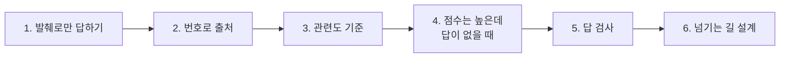
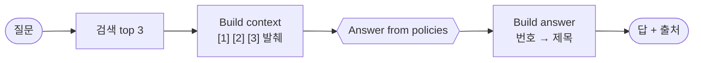
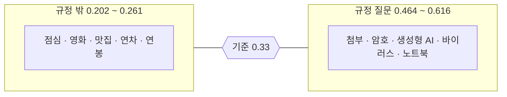
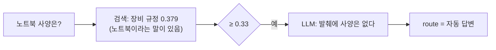
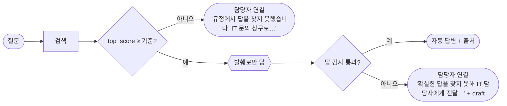

# 2단계 · 근거로 답하는 RAG 워크플로우

- 교시: 3~4교시 (11:00~12:50) · 3교시 강의 약 30분 + Lab 02 예제, 4교시 과제 · 풀이
- 실습: [Lab 02](../../Last3Mon/71/LAB-02-Q-ANSWER-FROM-POLICIES.md)
- 이 단계가 끝나면: 검색한 발췌로만 답하고 출처를 붙이는 워크플로우를 만들고, 관련 없는 질문과 **답이 없는 질문**을 서로 다른 장치로 넘길 수 있다.
- 이 교안의 숫자: 2026-10-18 수업 준비 측정, 2026-10-22 같은 정답으로 다시 돌린 기록 (`gpt-4.1-mini`, `text-embedding-3-large`)



| 절 | 말하는 시간 (예) | 띄울 것 |
| --- | --- | --- |
| 1. 발췌로만 답하기 | 6분 | 발췌의 실제 모양, 실측 답 |
| 2. 번호로 출처 | 4분 | `sources` · `cited` 실례 |
| 3. 관련도 기준 | 6분 | 10개 점수표, 기준 정하는 순서 |
| 4. 점수는 높은데 답이 없을 때 | 6분 | 기준값만 쓴 결과 |
| 5. 답 검사 | 6분 | 검사 4가지, 검사 결과 JSON |
| 6. 넘기는 길 설계 · 확인 질문 | 2분 + 과제 뒤 | route 세 갈래 |

## 1. 발췌로만 답하기



### 1.1 LLM이 실제로 받는 글

"암호를 얼마나 자주 바꿔야 해?"를 물으면 검색 1~3등(2. 변경 주기 0.576, 1. 만들기 0.512, 4. 다단계 인증 0.456)이 번호를 달고 LLM에게 갑니다.

```text
질문: 암호를 얼마나 자주 바꿔야 해?

규정 발췌:
[1] 비밀번호·계정 보안 규정
## 2. 변경 주기
- 비밀번호는 90일마다 바꾼다. 만료 7일 전부터 사내 포털에 변경 안내가 표시된다.
- 최근에 쓴 비밀번호 5개는 다시 쓸 수 없다.

[2] 비밀번호·계정 보안 규정
## 1. 비밀번호 만들기
- 비밀번호는 12자 이상으로 만든다. …

[3] 비밀번호·계정 보안 규정
## 4. 다단계 인증
- 회사 밖에서 사내 시스템에 접속할 때는 OTP 다단계 인증을 반드시 사용한다. …
```

LLM은 **이 글만** 봅니다. 규정 전체도, 다른 문서도 보지 않습니다. 그래서 1단계의 검색이 틀리면 여기서 고칠 방법이 없습니다.

### 1.2 지시문의 세 가지

| 지시 | 이유 |
| --- | --- |
| 발췌에 있는 내용으로만 | 지어내지 않게 (LLM이 아는 일반론을 섞지 않게) |
| 사실마다 `[번호]` | 코드가 출처를 확인할 수 있게 |
| 없으면 정확히 "규정에서 답을 찾지 못했습니다." | 모를 때의 답을 정해 둠 (그래도 다르게 말하기도 함, 4절) |

한국어 3문장 이내도 정합니다. 길면 발췌에 없는 설명이 붙기 쉽습니다.

### 1.3 실제 답 (`cases/lab02.json` 6/6, 2026-10-22)

| 질문 | 답 (앞부분) | 시간 |
| --- | --- | --- |
| 암호를 얼마나 자주 바꿔야 해? | "암호는 90일마다 변경해야 하며, 만료 7일 전부터 사내 포털에 변경 안내가 표시됩니다. … [비밀번호·계정 보안 규정]" | 3.0초 |
| 회사를 그만두면 노트북은 언제까지 돌려줘야 하나요? | "…퇴사 후 5영업일 이내에 IT 담당자에게 반납해야 합니다. … [업무용 장비 지급·반납 규정]" | 1.8초 |
| 첨부 파일이 너무 커서 메일이 안 보내져요 | "메일 첨부 파일은 25MB까지 … 사내 드라이브에 올리고 공유 링크를 … [메일·문서 보안 규정]" | 2.1초 |
| 오늘 점심 메뉴 추천해줘 | "규정에서 답을 찾지 못했습니다. IT 문의 창구로 연결해 드릴게요." (LLM 없음) | 0.3초 |

- 질문은 "암호"라고 물었는데 답도 "암호는 …"으로 시작합니다. LLM은 질문의 말투를 따르고, **내용**은 발췌를 따릅니다.
- LLM을 부르는 답은 1.8~3.0초, 부르지 않는 답은 0.3초입니다 (수업 준비 때 답 1.7~2.2초). 72일차에 이 차이를 재고 줄입니다.

### 1.4 틀린 전제

"비밀번호는 30일마다 바꾸면 되죠?"에는 "비밀번호는 30일마다 바꾸는 것이 아니라 90일마다 바꿔야 합니다. …"라고 답했습니다 (`top_score` 0.685). 질문이 아니라 **발췌**가 답의 기준이 됩니다. 사용자가 "맞죠?"라고 물으면 맞장구치기 쉬운 LLM을 발췌가 붙잡아 줍니다.

## 2. 번호로 출처

- LLM은 `[2]`처럼 **번호**만 씁니다. 번호를 문서 제목으로 바꾸고 `cited`(인용한 문서)를 만드는 것은 **Code**입니다.
- 범위 밖 번호(`[7]`)는 버립니다. LLM이 쓴 제목을 그대로 믿지 않습니다 (67일차 `sources`와 같은 생각).
- 결과에 `sources`(검색된 문서)와 `cited`(답이 인용한 문서)를 따로 둡니다.

### 2.1 질문 하나를 따라가 보기

질문: **"생성형 AI에 고객 자료를 넣어도 되나요?"** (실측)

**① 검색이 3개를 찾고 번호를 붙입니다.**

| 번호 | 문서 (`source`) | 섹션 | 점수 |
| --- | --- | --- | --- |
| [1] | `software-usage` (소프트웨어 사용 규정) | 3. 생성형 AI 서비스 | 0.51 |
| [2] | `privacy` (개인정보 처리 지침) | 2. 이용과 보관 | 0.367 |
| [3] | `privacy` (개인정보 처리 지침) | 1. 수집 | 0.336 |

**② LLM은 발췌 [1] [2] [3]을 읽고, 쓴 사실 뒤에 번호를 붙입니다.**

```text
"… 고객 정보, 개인정보, 대외비 문서는 생성형 AI 서비스에 입력하지 않는 것이 규정입니다[1]."
```

**③ Code가 결과의 두 칸을 만듭니다.**

| 칸 | 만드는 법 | 이 질문의 값 |
| --- | --- | --- |
| `sources` | 검색된 3개의 문서를 **중복 없이** 모음 ([1] · [2] · [3]) | `software-usage`, `privacy` (`privacy`가 두 번 나와 하나로) |
| `cited` | 답 안에 나온 **번호만** 문서로 바꿔 모음 | 답에 `[1]`만 있음 → `software-usage` |
| 답의 `[1]` | 번호를 그 문서의 제목으로 바꿈 | `[소프트웨어 사용 규정]` |

→ `sources`는 "LLM에게 **보여 준** 문서", `cited`는 "LLM이 답에 **실제로 쓴** 문서"입니다. 개인정보 지침도 보여 줬지만 답에는 쓰지 않았습니다.

### 2.2 두 칸을 비교해 읽기 (실측)

| 질문 | 보여 준 문서 (`sources`) | 답에 쓴 문서 (`cited`) | 읽는 법 |
| --- | --- | --- | --- |
| 생성형 AI에 고객 자료를 넣어도 되나요? | 소프트웨어, 개인정보 | 소프트웨어 | 위 2.1. 정상 |
| 첨부 파일이 너무 커서 메일이 안 보내져요 | 메일·문서, 보안 사고 | 메일·문서 | 3등(보안 사고 · 피싱 메일 0.335)은 관련 없어 쓰지 않음. 정상 |
| 비밀번호를 잊어버리면 어디서 바꿔요? | 비밀번호 | **없음** | 보여 줬는데 하나도 쓰지 않음. 답이 "규정에서 답을 찾지 못했습니다." → 발췌에 답이 없었다는 **신호** (4절) |

`cited`가 비어 있으면 답이 발췌를 근거로 하지 않았다는 뜻입니다. 5절 답 검사의 `cites_excerpt`가 이것을 봅니다.

왜 제목을 LLM에게 쓰게 하지 않나요? LLM은 발췌에 없는 제목("IT 보안 정책")을 만들어 내거나 비슷한 제목을 섞을 수 있습니다. 번호는 **코드가 범위를 확인**할 수 있고, 제목은 저장해 둔 메타데이터에서 가져오므로 틀릴 수 없습니다.

## 3. 관련도 기준

검색은 **언제나** 가장 가까운 청크 k개를 돌려줍니다. 점심 메뉴를 물어도 무언가 나옵니다. 1등 점수(`top_score`)가 기준보다 낮으면 LLM을 부르지 않고 넘깁니다.

### 3.1 실제로 잰 10개 (`cases/lab03-threshold.json` 10/10, 2026-10-22)

| 규정 질문 | `top_score` | | 규정 밖 질문 | `top_score` |
| --- | --- | --- | --- | --- |
| 첨부 파일이 너무 커서 … | 0.616 | | 올해 연봉 인상률은요? | 0.261 |
| 암호를 얼마나 자주 … | 0.575 | | 연차 휴가는 며칠이에요? | 0.259 |
| 생성형 AI에 고객 자료를 … | 0.51 | | 회사 근처 맛집 알려 줘 | 0.232 |
| 컴퓨터가 바이러스에 … | 0.478 | | 주말에 볼 영화 추천해 주세요 | 0.211 |
| 회사를 그만두면 노트북은 … | 0.464 | | 오늘 점심 메뉴 추천해줘 | 0.202 |



- 기준 0.33: 둘 다 맞게 나눔 (10/10). 넘기는 경우는 0.3~0.5초 (LLM 없음).
- 두 무리 사이가 0.2쯤 벌어져 있어 0.33은 여유가 있습니다.

### 3.2 기준값을 정하는 순서

1. 답이 **있는** 질문 몇 개, 답이 **없는**(관련 없는) 질문 몇 개를 정답표에서 고릅니다.
2. 두 무리의 `top_score`를 잽니다 (위 표).
3. 두 무리 **사이**에서, 경계에 딱 붙지 않게 고릅니다 (1단계 2.4절: 점수는 셋째 자리에서 흔들림).
4. 테스트 파일(`lab03-threshold.json`)로 남겨, 모델이나 청크를 바꿀 때마다 다시 돌립니다.

기준값은 **임베딩 모델마다 다릅니다.** 같은 질문도 모델이 바뀌면 점수대가 통째로 움직이므로, 다른 모델에서 가져온 숫자를 그대로 쓰지 않습니다.

### 3.3 기준은 양쪽으로 틀린다

| 기준을 올리면 | 기준을 낮추면 |
| --- | --- |
| 진짜 규정 질문도 넘김 (사람 일이 늘어남) | 관련 없는 질문에 LLM이 답을 씀 (지어낼 위험) |
| 예: 0.47로 올리면 "퇴사 노트북"(0.464)이 넘어감 | 예: 0.2로 내리면 점심 메뉴(0.202)에도 답을 씀 |

실제로 기준 근처에 있는 질문도 있습니다. 3단계 24문항 가운데:

| 질문 | 1등 | `top_score` | 규정에 답이 |
| --- | --- | --- | --- |
| 공짜 프로그램은 그냥 써도 되죠? | 소프트웨어 · 1. 설치와 승인 | **0.267** | **있음** ("라이선스") |
| 자리 비울 때 화면은 몇 분 뒤 잠기게 해요? | 원격근무 · 3. 재택근무 중 보안 | 0.354 | 있음 ("5분") |

"공짜 프로그램"은 규정에 답이 있는데 점수가 0.33보다 낮습니다. 이 점수면 규정 Q&A는 LLM을 부르지 않고 **담당자 연결**로 보냅니다. 기준값은 "답이 있는 질문을 넘기는" 쪽으로도 틀립니다. 그래도 지어낸 답을 내보내는 것보다 사람에게 넘기는 쪽이 안전하다고 보고 0.33을 둡니다. 이런 질문은 3단계의 질문 다시 쓰기로 점수를 올리는 길도 있습니다.

## 4. 점수는 높은데 답이 없을 때

### 4.1 기준값만 쓴 결과 (예제 정답, 2026-10-22, `lab02-challenge` 2/8)

| 질문 | `top_score` | route | LLM의 답 | `cited` |
| --- | --- | --- | --- | --- |
| VPN 접속 속도가 느리면 어떻게 해요? | 0.463 | 자동 답변 | "규정에서는 VPN 접속 속도가 느릴 때의 대처 방법에 대해 언급하고 있지 않습니다. 따라서 규정에서 답을 찾지 못했습니다." | 없음 |
| 노트북 사양은 어떻게 되나요? | 0.379 | 자동 답변 | "규정 발췌에는 노트북 사양에 대한 내용이 포함되어 있지 않습니다. … [업무용 장비 지급·반납 규정][메일·문서 보안 규정][업무용 장비 지급·반납 규정]" | **2개** |
| 비밀번호를 잊어버리면 어디서 바꿔요? | 0.551 | 자동 답변 | "규정에서 답을 찾지 못했습니다." | 없음 |
| 보안 교육은 1년에 몇 번 받아야 하나요? | 0.352 | 자동 답변 | "규정에서 답을 찾지 못했습니다." | 없음 |
| 연차 휴가는 며칠이에요? | 0.259 | 담당자 연결 | (LLM 없음) | 없음 |

**왜 답이 없나.** 이 질문들은 Lab 02 과제용으로 일부러 고른 것입니다. 낱말은 규정과 겹쳐 점수가 기준을 넘지만, 묻는 **내용**은 규정 8개 어디에도 없습니다 (원문 확인).

| 질문 | 점수를 올린 규정 | 그 규정에 있는 것 | 없는 것 (질문이 묻는 것) |
| --- | --- | --- | --- |
| VPN 접속 속도가 느리면? | 원격근무·VPN | VPN 먼저 연결, 공용 와이파이 금지, 인증서 1년 · 30일 전 재발급, 화면 잠금 | 속도가 느릴 때 할 일 |
| 노트북 사양은? | 장비 지급·반납 | 입사일 지급, 교체 주기 4년, 분실 신고, 반납 | 사양 (CPU · 메모리 등) |
| 비밀번호를 잊어버리면 어디서 바꿔요? | 비밀번호·계정 보안 | 12자 이상, 90일마다 변경, 5번 실패 시 30분 잠금, OTP 재등록 | 잊었을 때 다시 만드는 곳 · 방법 |
| 보안 교육은 1년에 몇 번? | 보안 사고 대응 | 피싱 메일 신고, 악성코드 감염 시 네트워크 분리 | 보안 교육 이야기 전부 |
| 연차 휴가는 며칠? | (가까운 규정 없음) | 규정 8개가 모두 IT 규정 | 인사 · 휴가 규정 자체 |

LLM은 발췌를 읽고 "찾지 못했다"고 **옳게** 답했습니다. 잘못은 워크플로우가 그 답을 `자동 답변`으로 내보낸 데 있습니다.

- 규정에 **비슷한 낱말**(VPN, 노트북, 비밀번호, 보안)이 있어 점수가 기준을 넘습니다. 기준을 0.47로 올리면 "퇴사 노트북"(0.464) 같은 진짜 규정 질문도 걸립니다 → **기준값으로는 못 거릅니다.**
- LLM은 모두 "못 찾았다"고 **말했지만**, 워크플로우는 그 답을 `자동 답변`으로 내보냈습니다. 직원 화면에는 "자동 답변: 규정에서 답을 찾지 못했습니다"가 뜨고, 아무도 이 문의를 이어받지 않습니다.
- 정해 준 문장 대신 "언급하고 있지 않습니다", "포함되어 있지 않습니다"처럼 **다르게** 말합니다.
- "노트북 사양"은 "내용이 없다"고 하면서 **출처를 셋이나** 붙였습니다. 출처가 있다고 근거 있는 답은 아닙니다 → 검사 하나로는 부족합니다.

### 4.2 왜 이런 일이 생기나



검색은 **주제**가 같은지를 보고, 답은 **내용**이 있는지가 중요합니다. 장비 규정은 노트북 이야기(지급 · 분실 · 반납)이지만 사양은 없습니다. 주제가 같으면 점수가 높고, 내용이 없으면 답이 없습니다. 이 틈은 검색 점수로는 볼 수 없고, **답을 보고** 판단해야 합니다.

## 5. 답 검사

67일차 Check answer처럼, LLM의 답을 코드로 검사하고 하나라도 실패하면 담당자에게 넘깁니다.

### 5.1 검사 넷

| 검사 | 확인 | 잡는 것 | 계산 방법 |
| --- | --- | --- | --- |
| `found_in_policies` | "찾지 못했", "포함되어 있지 않", "명시되어 있지 않", "언급이 없", "나와 있지 않"이 없나 | 답이 없는 질문 | 답 글에서 문구 찾기 (정규식) |
| `cites_excerpt` | 인용 번호가 하나 이상인가 | 출처 없는 답 | 범위 안의 `[번호]` 개수 |
| `grounded` | 답 글의 두 글자 묶음 30% 이상이 발췌에 있나 | 발췌와 상관없는 답 | 아래 5.2 |
| `numbers_from_policies` | 답의 숫자가 모두 발췌에 있나 | 지어낸 숫자 | 답의 숫자마다 발췌에서 찾기 |

### 5.2 `grounded`는 어떻게 세나

답에서 `[번호]`와 띄어쓰기를 빼고, 두 글자씩 묶습니다. "90일마다변경" → `90` `0일` `일마` `마다` `다변` `변경`. 이 묶음 중 발췌에도 있는 것이 30% 이상이면 통과입니다.

- 발췌의 말을 거의 그대로 옮긴 답은 높게 나오고, LLM이 아는 일반론("보통 IT 부서에 문의하시면…")을 쓴 답은 낮게 나옵니다.
- LLM으로 "근거가 있나"를 묻는 방법도 있지만, 그것도 LLM입니다. 두 글자 묶음은 **빠르고, 늘 같은 결과**이고, 왜 실패했는지 보여 줄 수 있습니다. 대신 말을 바꿔 쓴 좋은 답을 떨어뜨릴 수 있어 30%처럼 느슨하게 둡니다.

### 5.3 검사 결과 (과제 정답, `lab02-challenge` 2/8 → 8/8 · `--repeat 3` 24/24, `lab02` 6/6)

```json
{
  "route": "담당자 연결",
  "answer": "규정에서 확실한 답을 찾지 못해 IT 담당자에게 전달했습니다.",
  "draft": "규정에서는 VPN 접속 속도가 느릴 때의 대처 방법에 대해 언급하고 있지 않습니다. 따라서 답변을 드리기 어렵습니다. 규정에서 답을 찾지 못했습니다.",
  "cited": [],
  "top_score": 0.462,
  "checks": [
    {"name": "found_in_policies", "passed": false},
    {"name": "cites_excerpt", "passed": false},
    {"name": "grounded", "passed": false},
    {"name": "numbers_from_policies", "passed": true}
  ],
  "failed": ["found_in_policies", "cites_excerpt", "grounded"]
}
```

- 답이 없는 네 질문은 모두 `found_in_policies` · `cites_excerpt` · `grounded` 셋이 실패했습니다. 하나만 있었어도 걸렸겠지만, **여러 검사가 겹쳐** 있어 LLM이 말을 바꾸거나 출처를 붙여도 놓치지 않습니다.
- 근거 있는 답("암호", "바이러스", 틀린 전제)은 넷 다 통과해 그대로 `자동 답변`입니다.
- `draft`에 LLM의 원래 답을 남깁니다. 담당자가 이어받을 때 "무엇을 찾았고 왜 넘어왔는지"를 봅니다.
- 검사는 코드라 시간이 거의 들지 않습니다. 과제 정답에서 LLM을 부른 답은 1.1~1.9초였습니다 (`--repeat 3`, 2026-10-22).

> 장치마다 잡는 실패가 다릅니다. **관련도 기준** = 엉뚱한 질문 (빠르고 쌈, LLM을 부르지 않음), **답 검사** = 비슷하지만 답이 없는 질문, 지어낸 숫자 (LLM을 부른 뒤).

## 6. 넘기는 길 설계



| 갈래 | 언제 | 직원이 보는 말 | 담당자가 받는 것 |
| --- | --- | --- | --- |
| 자동 답변 | 기준 통과 + 검사 통과 | 답 + `[문서 제목]` | (없음) |
| 담당자 연결 (기준) | 관련 있는 규정이 없음 | "규정에서 답을 찾지 못했습니다. IT 문의 창구로 연결해 드릴게요." | 질문, `top_score` |
| 담당자 연결 (검사) | 규정은 비슷한데 답이 없거나 근거가 약함 | "규정에서 확실한 답을 찾지 못해 IT 담당자에게 전달했습니다." | 질문, `draft`, `failed` |

- 두 담당자 연결의 **말이 다릅니다.** 담당자는 "규정에 아예 없는 질문"과 "규정이 모자란 질문"을 다르게 처리합니다. 뒤쪽이 쌓이면 **규정을 보완할 곳**입니다 (VPN 속도, 노트북 사양, 비밀번호 찾기, 보안 교육 횟수).
- 69일차 검토자의 fail-closed와 같은 생각입니다: **확실하지 않으면 자동으로 내보내지 않습니다.**

### 6.1 앞 일차와의 연결

오늘 2단계는 새로 배우는 것이 아니라 **앞에서 한 세 가지를 RAG에 다시 쓰는 것**입니다.

| 일차 | 그때 만든 것 (장면 하나) | 그때 배운 것 | 오늘 같은 자리 |
| --- | --- | --- | --- |
| 64 Lab 02 | `miniflow`로 날씨 Tool → LLM. `city=제주`면 Tool 결과(`비`, 비 올 확률 80%)가 LLM 지시문에 끼워져 "우산이 필요합니다" | **근거를 지시문에 넣어 주면** LLM은 그것으로 답한다 (Tool → LLM 근거 제공 패턴) | 검색한 발췌 `[1] [2] [3]`을 지시문에 넣음 (1.1절). 날씨 Tool 자리에 검색이 들어감 |
| 67 Lab 01 과제 | IT 문의 Agent가 FAQ Tool로 답하고 `sources`에 `FAQ-001`처럼 출처를 남김 | 출처를 **LLM이 쓰게 할지, Tool 결과에서 코드가 찾게 할지** 정해야 함 | LLM은 번호만, 번호 → 문서 제목 · `cited`는 Code (2절) |
| 67 Lab 03 | Agent 답 뒤에 "결과 검증" 노드: 검사 여러 개, 하나라도 실패하면 `route: 담당자 연결` + 원래 답 `draft` + 걸린 검사 `failed` | LLM 답을 **코드로 검사**하고, 실패하면 사람에게 넘긴다 | 답 검사 넷과 같은 결과 모양 (`checks`, `failed`, `draft`) (5절) |
| 69 Lab 03 | 공지 팀(작성자 → 검토자 → 정리자)에서 **검토자를 꺼 봄**. 검토 결과(`passed`)가 없는데 `게시 가능`이 되면 가장 위험 | **fail-closed**: 확실하지 않으면 내보내지 않는다 (68일차는 fail-open: 하나가 꺼져도 나머지 답은 냄) | 검사 실패, 점수 미달 → `자동 답변` 하지 않고 담당자 연결 (6절) |
| 72 (내일) Lab 01 | `flow.py bench`로 같은 요청을 여러 번 보내 단계별 시간을 재고 가장 느린 단계를 찾음 | 느린 곳은 **재서** 찾는다 | 오늘 잰 것: LLM 없는 길 0.3초 vs LLM을 부르는 길 1.8~3.0초 |

수업에서는 "64일차 우산 질문 기억나나요? 그 날씨 Tool 자리에 오늘은 규정 검색이 들어갑니다"처럼 장면부터 꺼내면 됩니다.

## 확인 질문

<details><summary>1. 관련도 기준을 높이면 "답이 없는 질문" 문제가 풀리지 않나요?</summary>

아닙니다. 답이 없는 질문(0.352~0.551)과 진짜 규정 질문(0.464~0.616)의 점수대가 겹칩니다. 0.47로 올리면 "퇴사 노트북"(0.464)이 넘어가고, 그래도 "비밀번호 잊음"(0.551)은 남습니다. 답을 보고 판단하는 답 검사가 필요합니다.
</details>

<details><summary>2. "노트북 사양" 답에는 출처가 셋이나 있는데 왜 담당자에게 넘기나요?</summary>

답이 "내용이 포함되어 있지 않다"고 말하고 있습니다 (`found_in_policies` 실패). 출처가 있다는 것은 "발췌를 봤다"는 뜻이지 "발췌에 답이 있다"는 뜻이 아닙니다. 과제 정답에서는 출처가 붙지 않았지만, 붙더라도 다른 검사가 잡습니다.
</details>

<details><summary>3. <code>cited</code>를 LLM이 JSON으로 돌려주게 하면 안 되나요?</summary>

LLM은 없는 문서 이름을 만들거나 형식을 어길 수 있습니다. 번호를 쓰게 하고 코드가 범위를 확인한 뒤 저장된 메타데이터에서 이름을 가져오면, 출처가 틀릴 수 없습니다.
</details>

<details><summary>4. "공짜 프로그램은 그냥 써도 되죠?"(0.267)가 담당자에게 넘어가는 것은 실패인가요?</summary>

규정에 답이 있으니 놓친 것은 맞습니다. 하지만 지어낸 답이 나가는 것보다 덜 위험한 쪽으로 틀렸습니다. 이런 질문은 정답표에 남겨 두고, 3단계(질문 다시 쓰기)나 기준값 조정으로 나아지는지 숫자로 확인합니다.
</details>

<details><summary>5. 담당자 연결을 왜 두 가지 말로 나누나요?</summary>

"규정에 없는 주제"(점심 메뉴)와 "규정은 있는데 답이 모자란 질문"(VPN 속도)은 처리가 다릅니다. 뒤쪽은 규정 담당자가 문서를 보완할 거리이고, `draft` · `failed`가 그 근거가 됩니다.
</details>

## 정리

- [ ] 발췌로만, 번호로 출처, 모를 때의 답을 정한다. LLM은 발췌만 본다
- [ ] 번호 → 제목, `cited`는 코드가 만든다. `sources`와 `cited`가 다르면 이유가 있다
- [ ] 관련도 기준은 모델마다 두 무리를 재서 정하고, 양쪽으로 틀릴 수 있음을 안다
- [ ] 기준값으로 못 거르는 "답 없는 질문"은 답 검사(여러 개를 겹쳐)로
- [ ] 넘기는 길은 이유마다 다르게, 담당자가 이어받을 것(`draft`, `failed`)을 남긴다
