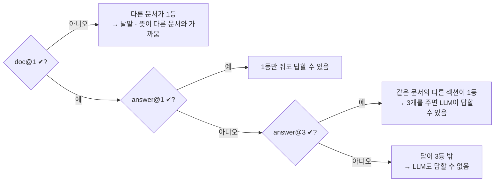
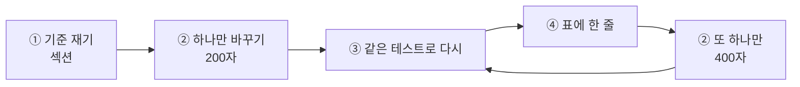

# 3단계 · 검색 품질 측정과 개선

- 교시: 5~6교시 (14:00~15:50) · 5교시 강의 약 30분 + Lab 03 예제, 6교시 과제 · 풀이
- 실습: [Lab 03](../../Last3Mon/71/LAB-03-Q-MEASURE-AND-IMPROVE.md)
- 이 단계가 끝나면: 검색 품질을 doc@1 · answer@1 · answer@3로 재고, 설정을 한 번에 하나씩 바꿔 비교하며, 개선이 다른 것을 깨뜨리지 않았는지 확인할 수 있다.
- 이 교안의 숫자: 2026-10-18 수업 준비 측정(1회), 2026-10-22 같은 정답으로 다시 돌린 기록. 두 날이 다른 곳은 따로 적었습니다.


| 절 | 말하는 시간 (예) | 띄울 것 |
| --- | --- | --- |
| 1. 지표 셋 | 6분 | 지표 표, 1등이 아슬아슬한 예 |
| 2. 재는 순서 | 4분 | 순서 그림, 실험 기록 |
| 3. 청크 크기 | 7분 | 설정 표, 잘린 문장 · 섞인 청크 |
| 4. 어려운 질문과 다시 쓰기 | 7분 | 8개 표 (다시 쓴 검색어) |
| 5. 같은 설정, 다른 결과 | 3분 | 10/18 vs 10/22 |
| 6. 무엇을 고를까 · 확인 질문 | 3분 + 과제 뒤 | 개선 방법 표 |

## 1. 지표 셋

**지표는 검색을 채점하는 방법입니다.** 질문 하나를 검색할 때마다 ✔ 또는 ✘를 하나 매기고, 24개 질문에서 ✔가 몇 개인지 셉니다. 세 지표는 **같은 검색 결과**를 서로 다른 기준으로 채점합니다.

- **doc** = 맞는 **문서**인가 (어느 규정에서 왔나만 봄)
- **answer** = 답 **문구**가 들어 있나 ("5영업일" 같은 글자가 청크 안에 있나)
- **@1, @3** = 위에서 **몇 등까지** 보나 (@1은 1등 하나만, @3은 1~3등 중 하나라도)

### 1.1 직접 채점해 보기 (섹션 청크, 2026-10-22)

질문 A **"비밀번호는 몇 자 이상이어야 하나요?"** 정답: 문서 `password-policy`, 답 문구 "12자"

| 순위 | 문서 · 섹션 | 점수 | 맞는 문서? | "12자" 있나? |
| --- | --- | --- | --- | --- |
| 1 | `password-policy` · 1. 비밀번호 만들기 | 0.748 | ✔ | ✔ |
| 2 | `password-policy` · 2. 변경 주기 | 0.54 | ✔ | |
| 3 | `password-policy` · 3. 로그인 실패와 잠금 | 0.484 | ✔ | |

→ doc@1 ✔ (1등이 맞는 문서) · answer@1 ✔ (1등에 "12자") · answer@3 ✔

질문 B **"회사를 그만두면 노트북은 언제까지 돌려줘야 하나요?"** 정답: 문서 `device-issue-return`, 답 문구 "5영업일"

| 순위 | 문서 · 섹션 | 점수 | 맞는 문서? | "5영업일" 있나? |
| --- | --- | --- | --- | --- |
| 1 | `device-issue-return` · 1. 지급과 교체 | 0.464 | ✔ | |
| 2 | `device-issue-return` · 3. 반납 | 0.45 | ✔ | ✔ |
| 3 | `device-issue-return` · 2. 분실과 도난 | 0.369 | ✔ | |

→ doc@1 ✔ (1등이 맞는 문서) · answer@1 **✘** (1등에는 "5영업일"이 없음) · answer@3 ✔ (2등에 있음)

질문 C **"챗GPT에 회의록 붙여 넣어도 돼요?"** 정답: 문서 `software-usage` (3. 생성형 AI 서비스), 답 문구 "입력하지 않는다"
(24문항이 아니라 Lab 03 과제의 어려운 질문입니다. 같은 섹션 청크로 질문 다시 쓰기 없이 잼. 답 문구는 이 예를 위해 원문 "고객 정보, 개인정보, 대외비 문서는 생성형 AI 서비스에 입력하지 않는다."에서 고름)

| 순위 | 문서 · 섹션 | 점수 | 맞는 문서? | "입력하지 않는다" 있나? |
| --- | --- | --- | --- | --- |
| 1 | `meeting-room` · 3. 사용 후 | 0.276 | ✘ | |
| 2 | `privacy` · 2. 이용과 보관 | 0.259 | ✘ | |
| 3 | `email-and-documents` · 2. 첨부 파일 | 0.259 | ✘ | |

→ doc@1 **✘** (1등이 회의실 규정) · answer@1 **✘** · answer@3 **✘** (맞는 문서가 3등 안에도 없음)

"회의록"이라는 낱말 때문에 회의실 규정이 1등이 됐고, 질문의 핵심인 "챗GPT"(규정은 "생성형 AI 서비스")는 잡지 못했습니다. 1등 점수도 0.276이라 2단계의 관련도 기준(0.33)에서 담당자 연결로 갑니다. doc@1이 ✘이면 answer 두 지표도 거의 늘 ✘입니다. 맞는 문서를 못 찾으면 답 문구도 없기 때문입니다. 4절에서 질문 다시 쓰기로 이 질문을 고칩니다.

질문 B는 지표마다 결과가 다릅니다. 이것이 지표를 셋이나 두는 까닭입니다.

| 지표 | 이 지표가 ✔이면 말할 수 있는 것 |
| --- | --- |
| doc@1 | 출처로 붙일 **규정은 맞게** 찾았다 |
| answer@1 | **1등 하나만** LLM에게 줘도 답할 수 있다 |
| answer@3 | 지금 Q&A처럼 **3개를 주면** LLM이 답할 수 있다 |

24개 질문 모두에 이렇게 매겨서 "24개 중 몇 개"로 적습니다. 섹션 청크의 결과는 doc@1 24 · answer@1 22 · answer@3 24입니다 (질문 B가 answer@1에서 틀린 두 개 중 하나).

### 1.2 테스트 파일이 채점하는 법

| 지표 | 묻는 것 | 테스트 파일 | 테스트가 보는 칸 |
| --- | --- | --- | --- |
| doc@1 | 1등 청크가 **맞는 문서**에서 왔나 | `retrieval-doc.json` | `hits.0.source` = 기대 문서 |
| answer@1 | 1등 청크에 **답 문구**가 있나 | `retrieval-answer.json` | `hits.0.text`에 "12자", "90일" … |
| answer@3 | 3등 안에 답 문구가 있나 | `retrieval-answer3.json` | `hits`(3개) 어딘가에 답 문구 |

- 질문 24개, 문서 8개. 각 질문의 정답(문서, 답 문구)은 Lab 01 예제 1처럼 사람이 정했습니다.
- 결과는 "24개 중 몇 개"입니다. 퍼센트로 바꾸지 않고 **몇 개 중 몇 개**로 말합니다 (24개에서 하나는 4%나 됩니다).

### 1.3 세 지표가 말해 주는 것



doc@1은 맞는데 answer@1이 틀리면 **맞는 문서의 다른 섹션**이 1등입니다. LLM에 3개를 주는 지금 설정에서는 answer@3이 "답할 수 있는지"를 말해 줍니다.

### 1.4 answer@1에서 틀린 두 질문 들여다보기 (섹션 청크)

섹션 청크의 answer@1은 24개 중 **22개**입니다. 틀린 두 개가 무엇이고 왜 틀렸는지 봅니다. 두 날(10/18, 10/22) 모두 같은 두 질문이 틀렸습니다.

**① 무엇이 틀렸나: 1등과 2등의 점수가 거의 같다**

| 질문 | 1등 (답 없음) | 2등 (**답이 있는 섹션**) | 점수 차이 |
| --- | --- | --- | --- |
| 회사를 그만두면 노트북은 언제까지 돌려줘야 하나요? (1.1의 질문 B) | 장비 · 1. 지급과 교체 0.464 | 장비 · 3. 반납 0.45 ("5영업일") | 0.014 |
| 고객 정보가 밖으로 샌 것 같아요 | 개인정보 · 2. 이용과 보관 0.395 | 개인정보 · 3. 유출 대응 0.375 ("1시간") | 0.02 |

둘 다 **문서는 맞았습니다** (doc@1 ✔). 같은 문서 안에서 답이 있는 섹션이 아주 작은 차이로 2등이 됐을 뿐입니다. 0.014는 1단계 2.4절에서 본 "실행마다 흔들리는 폭"(셋째 자리)보다 조금 큰 정도라, 질문을 조금만 바꿔도 순서가 뒤집힐 수 있습니다. 그래서 "아슬아슬"입니다.

**② 왜 틀렸나: 질문에 나온 낱말이 어느 섹션에 있나**

질문마다 원 질문, 질문이 정말 묻는 것, 1등 · 2등 섹션의 원문을 차례로 봅니다. **굵은 글자**가 질문과 섹션에 똑같이 나오는 낱말입니다.

질문 1. "회사를 그만두면 **노트북**은 언제까지 돌려줘야 하나요?"

- 질문이 정말 묻는 것: 퇴사할 때 **반납** 기한 → 답은 3절 "5영업일"

| 순위 | 섹션 | 점수 | 원문 | 질문과 같은 낱말 |
| --- | --- | --- | --- | --- |
| 1등 | 1. 지급과 교체 | 0.464 | 업무용 **노트북**은 입사일에 지급한다. **노트북** 교체 주기는 4년이다. | "노트북" 2번 |
| 2등 (답) | 3. 반납 | 0.45 | 퇴사하거나 장비를 교체할 때는 5영업일 이내에 장비를 IT 담당자에게 반납한다. | 없음 ("노트북" 대신 "장비") |

질문 2. "**고객** 정보가 밖으로 샌 것 같아요"

- 질문이 정말 묻는 것: 개인정보 **유출** 때 할 일 → 답은 3절 "1시간 이내 신고"

| 순위 | 섹션 | 점수 | 원문 | 질문과 같은 낱말 |
| --- | --- | --- | --- | --- |
| 1등 | 2. 이용과 보관 | 0.395 | **고객** 개인정보가 보이는 화면은 캡처하거나 촬영하지 않는다. | "고객" |
| 2등 (답) | 3. 유출 대응 | 0.375 | 개인정보가 유출되었거나 유출이 의심되면 1시간 이내에 보안팀에 신고한다. | 없음 ("밖으로 샌" 대신 "유출") |

두 질문 모두 같은 모양입니다.

- 1등 섹션에는 질문에 나온 **명사가 그대로** 있지만, 질문이 묻는 내용(반납, 유출)은 없습니다.
- 2등 섹션에 답이 있지만, 질문과 **다른 낱말**("장비", "유출")로 쓰여 있습니다.
- 그래서 임베딩이 1등 섹션을 아주 조금 더 가깝게 본 것으로 보입니다. 원문과 점수를 보고 한 해석이고, 원인을 따로 실험해 재지는 않았습니다.

**③ 그래서 어떻게 되나: 3개를 주면 답은 맞는다**

answer@3은 두 질문 모두 ✔입니다 (답이 2등에 있으니까). 2단계 Q&A는 발췌 3개를 LLM에게 주므로, 실제로 "회사를 그만두면 노트북은?"에 "퇴사 후 5영업일 이내에 … 반납해야 합니다"라고 맞게 답했습니다 (Lab 02 `lab02.json`, 2026-10-22).

| 이런 틀림이 문제가 되는 때 | 문제가 덜 되는 때 |
| --- | --- |
| 1등 하나만 쓰는 설계 (답 대신 "관련 규정 바로가기" 하나만 보여 주기 등) | 지금처럼 3개를 LLM에게 주는 Q&A |

4절의 질문 다시 쓰기는 "그만두면 → 퇴사"처럼 질문을 규정 낱말로 바꿔 이런 틀림을 줄입니다. 실제로 "노트북" 질문은 다시 쓰기 뒤 answer@1이 맞았습니다.

## 2. 재는 순서

**하고 싶은 것**: "청크를 섹션으로 자르는 것과 200자 · 400자로 자르는 것 중 어느 것이 검색을 잘하나?"를 숫자로 비교하기.

**원칙 두 가지**

1. **출발점(기준)을 먼저 잰다.** 지금 쓰는 설정(섹션)의 점수를 알아야 바꾼 뒤 좋아졌는지 나빠졌는지 압니다.
2. **한 번에 하나만 바꾼다.** 청크 크기와 기준값을 함께 바꾸고 점수가 오르면, 무엇 때문에 올랐는지 모릅니다.



### 2.1 실제로 한 바퀴씩 (Lab 03 예제 1 · 2, 2026-10-22)

색인 워크플로우(`my-index`)는 요청 본문의 `chunking` 값을 보고 자르는 방식을 정합니다. 그래서 **워크플로우를 고치지 않고** 요청만 바꿔 다시 색인하면 됩니다.

| 바퀴 | 명령 | 하는 일 | 결과 |
| --- | --- | --- | --- |
| ① 기준 | `call my-index requests/index-section.json -v` | 섹션으로 다시 색인 (`{"chunking": "section"}`) | 청크 25개 |
| | `test cases/retrieval-answer.json -v --no-before` | 지금 색인 그대로 24문항 채점 | answer@1 **22**/24<br>틀림: 퇴사 노트북, 고객 정보 유출 |
| ② 200자 | `call my-index requests/index-200.json -v` | 200자로 다시 색인 (`{"chunking": 200}`) | 청크 20개 |
| | `test cases/retrieval-answer.json -v --no-before` | 같은 24문항 다시 채점 | answer@1 **20**/24<br>틀림: VPN 인증서, 퇴사 노트북, 개인정보 파일 메일, 공짜 프로그램 |
| ③ 400자 | `call my-index requests/index-400.json -v` | 400자로 다시 색인 | 청크 12개 |
| | `test cases/retrieval-answer.json -v --no-before` | 같은 24문항 다시 채점 | answer@1 **22**/24<br>틀림: 개인정보 파일 메일, 화면 잠금 |

→ 바꾼 것은 매번 **청크 자르는 방식 하나**뿐이고, 채점은 매번 **같은 24문항**입니다. 그래서 22 → 20 → 22의 차이는 청크 크기 때문이라고 말할 수 있습니다.

섹션과 400자가 둘 다 22인 것은 **우연히 개수가 같을 뿐**입니다. 틀린 질문이 겹치지 않습니다: 섹션이 틀린 두 질문을 400자는 맞혔고, 섹션이 맞힌 다른 두 질문을 400자는 틀렸습니다. 그래서 숫자 옆에 **틀린 질문**을 함께 적습니다 (3.3절).

### 2.2 `--no-before`를 붙이는 까닭

케이스 파일에는 `before` 칸이 있어서, `test`는 원래 **채점 전에 섹션으로 다시 색인**합니다 (1단계 5절). 평소에는 편하지만, 여기서는 방금 200자로 해 둔 색인을 섹션으로 덮어써 버립니다.

| | 출력 첫 줄 | 실제로 잰 것 |
| --- | --- | --- |
| `--no-before`를 붙임 | (before 줄 없음) | 200자 색인 ✔ |
| 빼먹음 | `✔ before: POST /webhook/my-index … {"indexed_chunks": 25, "chunking": "section"}` | **섹션** 색인 ✘ (200자를 쟀다고 착각) |

출력 첫 줄에 `before`가 있으면 다시 잽니다.

### 2.3 실험 기록 한 줄에 들어갈 것

| 칸 | 예 | 왜 |
| --- | --- | --- |
| 날짜 · 모델 | 2026-10-22, `text-embedding-3-large` | 모델이 바뀌면 숫자도 바뀜 |
| 바꾼 것 하나 | 청크 섹션 → 200자 | 무엇의 효과인지 |
| 청크 수 | 25 → 20 | 설정이 정말 적용됐는지 |
| 지표 셋 | doc@1 24 · answer@1 20 · answer@3 24 (10/18에 셋 다 잼) | 좋아진 것과 나빠진 것 |
| 틀린 질문 | "VPN 인증서", "공짜 프로그램" … | 숫자가 같아도 틀린 질문이 다를 수 있음 |
| 보고서 | `runs/retrieval-answer-….json` | 다시 열어 볼 근거 |

`templates/RAG-EVAL-TEMPLATE.md` 4절이 이 표입니다. **틀린 질문** 칸을 빼먹기 쉽습니다 (3.3절).

## 3. 청크 크기

### 3.1 잰 표

| 설정 | 청크 수 | doc@1 | answer@1 | answer@3 |
| --- | --- | --- | --- | --- |
| 섹션 | 25 | 24/24 | 22/24 | 24/24 |
| 200자 | 20 | 24/24 | 20/24 | 24/24 |
| 400자 | 12 | 22/24 | 22/24 | 24/24 |

(10/18 수업 준비. 10/22에는 섹션 지표 셋과 200자 · 400자 answer@1을 다시 재어 같은 값.)

- 우리 규정 문서는 짧아서(문서 하나에 섹션 2~4개, 526~928바이트) 400자로 자르면 청크가 오히려 **줄고** 섹션이 섞입니다. 청크 크기는 **내 문서 모양**을 보고 정합니다.
- answer@3은 모두 24/24 → 3개를 주면 청크 크기 차이가 답에 덜 드러납니다. 대신 LLM에 주는 글이 길어집니다 (75일차 비용).

<details><summary>수강생이 "answer@3이면 다 맞으니 그걸로 되는 것 아닌가요?"라고 물으면</summary>

"이 24문항과 이 짧은 문서에서는 그렇습니다. 그래서 answer@3만 보면 안 됩니다."

| 까닭 | 근거 (오늘 잰 것) |
| --- | --- |
| 3개가 **전체에서 차지하는 몫**이 큼 | 섹션은 25개 중 3개(12%), 400자는 12개 중 3개(25%, 규정 전체의 4분의 1). 25개를 다 주면 answer@25는 늘 24/24지만 그건 검색을 안 한 것과 같음. 문서가 수천 개면 3개는 아주 작은 몫 |
| 24문항은 **쉬운 쪽** | 모두 답이 있고 규정 낱말에 가까움. 어려운 질문 "챗GPT에 회의록 …"은 섹션에서도 맞는 문서가 3등 안에 없음 (1.1절 질문 C) |
| 3등 안에 있어도 **Q&A가 답하지 못할 수 있음** | 400자 "화면 잠금"은 1등 점수 0.241 → 관련도 기준 0.33 아래라 LLM을 부르지 않고 담당자 연결. answer@3은 검색만 채점하고 기준값은 보지 않음 |
| 많이 줄수록 LLM 일이 어렵고 비쌈 | 2단계 "노트북 사양"은 관련 없는 발췌(0.234 · 0.215)까지 출처로 붙임. 글이 길수록 시간 · 비용 (75일차) |

→ answer@3은 "3개를 주면 **답할 재료는 있다**", answer@1 · doc@1은 "검색이 **얼마나 정확한가**". 설정 사이의 차이는 answer@1 · doc@1에서 보입니다.
</details>

### 3.2 200자: 문장이 잘린다

200자 색인에서 "VPN 인증서는 언제 다시 받아야 해요?"(답 "30일 전")가 answer@1을 틀렸습니다. 1등 청크(0.545)는 이렇게 시작합니다:

```text
원격근무·VPN 이용 규정
포털의 '인증서 재발급' 메뉴에서 새 인증서를 신청한다.
- 인증서가 만료되면 VPN에 접속할 수 없으므로, 만료 전에 재발급한다.
## 3. 재택근무 중 보안 …
```

원래 문장은 "만료 **30일 전부터** IT 포털의 '인증서 재발급' 메뉴에서 새 인증서를 신청한다."입니다. 200자 경계가 이 문장 **한가운데**를 지나서, 앞부분("30일 전부터 … 새 인증서를")은 앞 청크(2등, 0.505)로, 뒷부분은 이 청크로 갔습니다. 답 문구가 1등 청크에 없습니다.

하나 더: 이 청크의 `section` 칸은 "3. 재택근무 중 보안"이었습니다. 청크 안의 첫 `## ` 제목을 섹션으로 붙이게 했기 때문에, 섹션 2의 뒷부분이 섹션 3 이름을 달았습니다. **글자 수로 자르면 출처 이름도 어긋날 수 있습니다.**

### 3.3 400자: 섹션이 섞인다

400자 색인은 청크 12개입니다. 원격근무 문서는 400자 안에 통째로 들어가서 **섹션 셋(접속 원칙 · VPN 인증서 · 재택근무 중 보안)이 모두 한 청크**가 됐습니다. 그 결과:

| 질문 (400자) | 1등 | 답("5분")이 든 청크 | 섹션 색인에서는 |
| --- | --- | --- | --- |
| 자리 비울 때 화면은 몇 분 뒤 잠기게 해요? | 회의실 · 1. 예약 **0.241** (틀림) | 원격근무 섹션 셋이 섞인 청크, **2등 0.236** | 원격근무 · 3. 재택근무 중 보안 1등 0.354 (맞음) |

여러 주제가 한 청크에 섞이면 그 청크의 벡터는 **어느 주제와도 덜 가깝게** 됩니다. "화면 잠금" 질문의 1등이 0.241로 규정 밖 질문의 점수대(0.20~0.26)까지 내려왔고, 엉뚱한 회의실 규정이 1등이 됐습니다. 답이 든 청크는 2등이라 answer@3은 ✔지만, 1등 점수가 0.241이라 2단계의 관련도 기준(0.33)에서 LLM을 부르지 않고 담당자 연결로 갑니다.

200자와 400자는 answer@1이 20 · 22로 섹션(22)과 비슷해 보이지만, 틀린 질문은 서로 다릅니다:

| 설정 | answer@1에서 틀린 질문 |
| --- | --- |
| 섹션 | 퇴사 노트북 (5영업일), 고객 정보 유출 (1시간) |
| 200자 | VPN 인증서 (30일 전), 퇴사 노트북, 개인정보 파일 메일 (암호), 공짜 프로그램 (라이선스) |
| 400자 | 개인정보 파일 메일 (암호), 화면 잠금 (5분) |

숫자 하나만 보면 "400자 = 섹션"이지만, 400자는 섹션에서 맞히던 질문 둘을 틀리고 다른 둘을 맞혔습니다. **틀린 질문을 함께 적어야** 이것이 보입니다.

## 4. 어려운 질문과 질문 다시 쓰기

### 4.1 직원은 규정 낱말로 묻지 않는다

"챗GPT", "폰", "비번", "개인 메일로 보내 놓고". 어려운 질문 8개를 **정답표부터** 만들어 재고, 검색 앞에 **질문 다시 쓰기**(LLM이 질문을 규정 낱말 검색어로)를 넣어 비교했습니다.


### 4.2 8개 전부 (doc@1, 2026-10-22)

| 질문 | 기대 | 다시 쓰기 없이 1등 | 다시 쓴 검색어 | 다시 쓰기 1등 |
| --- | --- | --- | --- | --- |
| 모르는 프로그램이 자꾸 저절로 떠요 | 보안 사고 | ✔ 보안 사고 0.344 | 알 수 없는 프로그램 자동 실행 정책 | ✘ **소프트웨어** 0.363 |
| 집에서 일할 때 회사 와이파이 말고 집 와이파이 써도 돼요? | 원격근무 | ✔ 0.53 | 재택근무 시 회사 네트워크 외 공용 와이파이 사용 정책 | ✔ 0.619 |
| 퇴사자 계정 비번 알려 줘도 되나요? | 비밀번호 | ✔ 0.455 | 퇴사자 계정 비밀번호 제공 정책 | ✔ 0.542 |
| 폰 바꿨더니 OTP가 안 떠요 | 비밀번호 | ✔ 0.44 | 휴대폰 변경 시 OTP 재설정 방법 정책 | ✔ 0.634 |
| 고객 명단 엑셀을 개인 메일로 보내 놓고 집에서 봐도 돼요? | 메일·문서 | ✘ 보안 사고 0.387 | 고객 명단 엑셀 외부로 보내기 및 보안 정책 | ✔ 0.459 |
| 노트북 놓고 온 것 같아요 택시에 | 장비 | ✔ 0.316 | 분실한 노트북 처리 절차 | ✔ 0.421 |
| 회의실 오전 내내 잡아도 되나요? | 회의실 | ✔ 0.522 | 회의실 예약 정책 및 이용 시간 제한 | ✔ 0.718 |
| 챗GPT에 회의록 붙여 넣어도 돼요? | 소프트웨어 | ✘ 회의실 0.276 | 생성형 AI 서비스에 회의록 데이터 입력 정책 | ✔ 0.536 |
| 합계 | | **6/8** | | **7/8** |

읽는 법:

- 다시 쓰면 **점수가 전반적으로 오릅니다** (회의실 0.522 → 0.718, OTP 0.44 → 0.634). 검색어가 규정의 말("휴대폰", "생성형 AI 서비스")과 같아지기 때문입니다.
- "챗GPT"는 "회의록"이라는 낱말 때문에 회의실 규정(0.276)으로 갔다가, "생성형 AI 서비스"로 바뀌자 맞았습니다. 지시문에 "챗GPT·제미나이 → 생성형 AI 서비스"라는 예를 넣었기 때문입니다.
- "모르는 프로그램이 자꾸 떠요"는 **새로 틀렸습니다.** "프로그램 자동 실행"이라는 검색어가 소프트웨어 **설치** 규정 쪽으로 갔습니다. 직원이 말한 것은 "감염된 것 같다"였는데, 다시 쓰기가 그 뜻을 지웠습니다.
- "노트북 놓고 온 것 같아요 택시에"는 다시 쓰기가 "분실"이라는 핵심 낱말을 찾아 줬습니다 (0.316 → 0.421). 다시 쓰기 없이 0.316이면 관련도 기준(0.33) 아래라 담당자 연결로 갔을 질문입니다.

### 4.3 지시문을 고친 이야기 (수업 준비 때)

| 판 | 지시문의 예 | 결과 |
| --- | --- | --- |
| 1판 | "암호 → 비밀번호"처럼 예 하나 | "챗GPT"를 바꾸지 못함 → 검색어에 "챗GPT 사용 시 회의록 개인정보" |
| 2판 (정답) | 그만두면 → 퇴사, 깔다 → 설치, 챗GPT·제미나이 → 생성형 AI 서비스, 개인 메일로 보내다 → 외부로 보내다·첨부 파일, 폰 → 휴대폰 | 위 표 7/8 |

2판은 **실패한 질문에서 찾은 낱말**을 넣었습니다. 시험 문제를 보고 답을 외운 것처럼, 이 8개에만 맞춘 것일 수 있습니다. 그래서 원래 24문항으로 **함께** 다시 쟀습니다:

| 24문항 | 다시 쓰기 없이 | 다시 쓰기 (10/18) | 다시 쓰기 (10/22) |
| --- | --- | --- | --- |
| doc@1 | 24 | 24 | 24 |
| answer@1 | 22 | **24** | **23** |
| answer@3 | 24 | 24 | 24 |
| 검색 한 번 | 0.2~0.5초 | 0.9~1.6초 | 1.0~2.0초 |

다른 질문을 망가뜨리지 않았고(doc@1 · answer@3 그대로), 대신 검색마다 LLM을 한 번 더 불러 **1초쯤 느려졌습니다.**

### 4.4 어려운 질문을 만드는 법

| 방법 | 예 |
| --- | --- |
| 줄임말 · 외래어 | 비번, 폰, 챗GPT |
| 상황으로 말하기 | "노트북 놓고 온 것 같아요 택시에" (= 분실) |
| 두 규정에 걸치기 | "고객 명단 엑셀을 개인 메일로" (개인정보? 메일?) |
| 다른 규정의 낱말이 섞임 | "챗GPT에 **회의록**" (회의실 규정으로 끌려감) |

처음 쓴 어려운 질문 하나는 "윈도우 업데이트 안 하고 미루면 안 돼요?"였습니다. 기대 문서를 `security-incident`로 적었는데, 규정에 윈도우 업데이트 이야기가 **없었습니다** (1등은 `software-usage` 0.309, 8개 중 5개 맞음. 자세히는 1단계 3.3절). 어려운 질문도 정답표부터, 원문을 열어 확인합니다. 답이 없는 질문은 검색 테스트가 아니라 2단계 답 검사 테스트로 보냅니다.

## 5. 같은 설정, 다른 결과

같은 정답 워크플로우로 10/22에 다시 재니, 다시 쓰기 뒤 answer@1이 **24 → 23**이 됐습니다.

| | 10/18 | 10/22 |
| --- | --- | --- |
| "고객 정보가 밖으로 샌 것 같아요"의 다시 쓴 검색어 | 고객 정보 외부 유출 **대응 방안** | 고객 정보 외부 유출 **방지 정책** |
| 1등 | 개인정보 · 3. 유출 대응 0.559 ✔ | 개인정보 · 2. 이용과 보관 0.547 ✘ |
| 2등 | 개인정보 · 2. 이용과 보관 0.487 | 개인정보 · 3. 유출 대응 0.51 |

- 검색 앞에 LLM을 두면 **검색도 매번 조금씩 달라집니다.** "대응"이 "방지"로 바뀌자 답 섹션이 2등으로 내려갔습니다.
- 답이 3등 안에는 있어 answer@3은 그대로 24입니다. 2단계 Q&A는 3개를 주므로 답에는 영향이 적습니다.
- 다시 쓰기를 넣었다면 `--repeat 3`으로 재고 "22~24"처럼 **범위**로 적습니다. 한 번 잰 24는 운이 좋았던 것일 수 있습니다.
- LLM이 없는 검색(섹션 청크)은 두 날 모두 22로 같았습니다. 점수도 셋째 자리에서만 흔들립니다 (1단계 2.4절).

## 6. 무엇을 고를까

| 개선 | 좋은 점 | 대가 | 오늘 잰 것 |
| --- | --- | --- | --- |
| 청크를 뜻 단위로 (섹션) | 공짜, 가장 큰 차이일 때가 많음 | 문서에 구조가 있어야 함 | 섹션 22 vs 200자 20 (answer@1) |
| 질문 다시 쓰기 | 구어체 · 다른 이름에 강함 | LLM 한 번 더 (약 1초, 비용), 새로 틀리는 질문, 실행마다 다름 | 어려운 8개 6 → 7, 24문항 answer@1 22 → 23~24 |
| 같은 뜻 낱말표 (Code) | 빠르고 늘 같은 결과 | 표를 사람이 관리 | (재지 않음) |
| `top_k` 늘리기 | answer@k가 오름 | LLM에 주는 글이 길어짐 | answer@1 22 → answer@3 24 |
| 임베딩 모델 바꾸기 | 한국어에 맞는 모델이면 큰 차이 | 기준값도 다시 재야 함 | (재지 않음) |
| 낱말 검색과 섞기 (BM25 + 임베딩) | 고유명사 · 숫자에 강함 | 섞는 비율을 또 재야 함 | (강사 바이브 코딩 거리) |

> 고르는 기준은 "어느 것이 좋다더라"가 아니라 **내 문서 · 내 질문으로 잰 숫자**입니다. 좋아진 것과 나빠진 것을 함께 적습니다.

### 6.1 언제 멈추나

- 정답표의 **중요한 질문**(자주 묻는 것, 틀리면 위험한 것)이 다 맞으면 멈춥니다. 24개 모두를 늘 맞히려고 지시문에 예를 계속 더하면, 그 24개에만 맞춘 검색이 됩니다.
- 남은 실패는 **어디서 막는지** 적습니다: answer@3 안에 있으면 LLM이 답할 수 있고, 아니면 2단계의 기준값 · 답 검사가 담당자에게 넘기는지 확인합니다.
- 새 질문이 들어오면 정답표에 더하고 다시 잽니다. 정답표는 한 번 쓰고 끝나는 것이 아니라 **함께 자랍니다** (77일차 지표, 79일차 골든 질문).

## 확인 질문

<details><summary>1. doc@1이 24/24인데 answer@1이 22/24입니다. 무엇이 문제인가요?</summary>

맞는 문서는 찾았지만 그 문서의 다른 섹션이 1등입니다 (예: "퇴사 노트북"은 지급 섹션 0.464, 반납 섹션 0.45). answer@3이 24/24라면 3개를 주는 Q&A는 답할 수 있습니다.
</details>

<details><summary>2. 200자로 바꿨는데 결과가 섹션과 똑같이 나왔습니다. 무엇을 의심하나요?</summary>

`--no-before`를 빼먹어 테스트의 `before`가 섹션으로 다시 색인했을 수 있습니다. 결과 첫 줄에 `✔ before:`가 있는지, `call my-index` 응답의 `indexed_chunks`가 20인지 확인합니다.
</details>

<details><summary>3. 400자의 answer@1이 22로 섹션과 같습니다. 400자를 써도 되나요?</summary>

숫자는 같지만 틀린 질문이 다릅니다 (400자는 "화면 잠금"을 0.241로 틀림). doc@1은 22로 더 나쁘고, 섞인 청크는 관련도 기준 아래로 떨어질 수 있습니다. 우리 문서에서는 섹션이 낫습니다.
</details>

<details><summary>4. 질문 다시 쓰기로 7/8이 됐습니다. 남은 1개를 맞히려면 지시문에 "모르는 프로그램 → 악성코드"를 넣으면 되나요?</summary>

그 질문은 맞겠지만 이 8개에 맞춘 것이 됩니다. 넣는다면 24문항과 다른 질문으로 함께 다시 재고, 새로 틀리는 것이 없는지 봅니다. 그리고 `--repeat`으로 여러 번 잽니다.
</details>

<details><summary>5. 다시 쓰기 뒤 answer@1이 24였다가 다음 날 23이 됐습니다. 무엇이 바뀌었나요?</summary>

워크플로우는 같습니다. LLM이 다시 쓴 검색어가 실행마다 달라 ("대응 방안" → "방지 정책") 1 · 2등이 바뀌었습니다. LLM이 검색 앞에 있으면 결과를 범위로 적습니다.
</details>

## 정리

- [ ] doc@1 · answer@1 · answer@3을 같은 질문 목록으로. 세 지표의 조합으로 어디서 틀렸는지 읽는다
- [ ] 한 번에 하나만 바꾸고, 표에 한 줄씩 (틀린 질문까지). `--no-before`를 확인한다
- [ ] 청크 크기는 내 문서 모양을 보고. 글자 수는 문장을 자르고, 큰 청크는 주제를 섞는다
- [ ] 개선 뒤에는 원래 테스트도 다시: 새로 틀린 것도 결과다
- [ ] 검색 앞에 LLM이 있으면 결과가 실행마다 다르다 → 여러 번, 범위로
