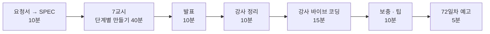

# 7·8교시 · 바이브 코딩 (`tdoc`)

- 교시: 7교시 16:00~16:50 (각자 만들기), 8교시 17:00~17:50 (발표 · 정리 · 강사 바이브 코딩 · 팁 · 예고)
- 과제: [VIBE-REQ-TDOC](../../Last3Mon/71/VIBE-REQ-TDOC.md)(요청서) → 학생이 직접 쓰는 `SPEC.md` → [VIBE-Q-TDOC](../../Last3Mon/71/VIBE-Q-TDOC.md)(요구 · 단계)와 비교 → 만들기 → 수업 뒤 `VIBE-A-TDOC.md` 공개
- 68 · 69일차와 같은 흐름입니다: 사람의 말(요청서)을 **확인할 수 있는 요구**로 바꾸는 일을 학생이 먼저 하고, VIBE-Q는 그 다음 단계(비교 대상)로 씁니다.
- 오늘은 `tdoc`: 내 md 문서를 임베딩해 SQLite에 저장하고, 질문하면 답과 근거 문단을 보여 주는 RAG TUI. 설정을 바꿔 같은 질문 목록으로 비교합니다. 오늘 n8n으로 한 일을 내 문서에 직접.

## 1. 7교시 · 각자 만들기 (50분)

| 시간 | 단계 | 확인 |
| --- | --- | --- |
| 16:00~16:02 | 0. 준비 (`~/vibe/tdoc`, `git init`, 키 환경 변수). **에이전트는 아직 켜지 않음** | |
| 16:02~16:12 | 0. 요청서 → `SPEC.md` (직접) → VIBE-Q와 비교 · 고치기 · commit | 요구마다 확인 방법(호출 수 · 줄 수 · 맞은 수), 숨은 요구, 비교한 줄 |
| 16:12~16:25 | 1. 색인 · 검색 (R1 · R2). 첫 요청은 "SPEC.md를 읽고 확인 방법부터 말해" | 두 번째 색인은 임베딩 0번, `tdoc search` |
| 16:25~16:35 | 2. 답 · 근거 (R3) | 근거 번호, 점수 낮으면 LLM 없이 모른다고 |
| 16:35~16:45 | 3. TUI · 비교 (R4 · R5) | `tdoc eval` 두 설정 |
| 16:45~16:50 | 4. 정리 · `SPEC.md` 체크 · 발표 메모 | |

16:00에 화면에 띄울 것: 요청서의 ①~⑤와 예 하나(① → R1). "부탁은 확인할 수 없습니다. 호출 수 · 줄 수 · 맞은 수로 바꿉니다." 16:10쯤 "VIBE-Q를 열어 비교하세요"를 알립니다.

| 볼 것 | 막혔을 때 한마디 |
| --- | --- |
| 색인할 때마다 전부 다시 | "파일 해시로 바뀐 파일만" |
| 테스트가 진짜 임베딩을 부름 | "가짜 임베딩으로" |
| 근거 없이 답함 | "발췌로만, 번호로, 점수 낮으면 LLM 부르지 않기 — 오늘 Lab 02" |
| 비교 없이 "잘 되는 것 같아요" | "질문 5개 정답표를 먼저" |
| SPEC 없이 VIBE-Q를 통째로 붙여 넣었나 | "요청서로 SPEC.md부터. 확인 방법이 없으면 됐는지 모릅니다" |
| SPEC에 부탁만 ("빠르게", "지어내지 않게") | "다시 색인하면 임베딩이 몇 번 불려야 하나요? 숫자로" |
| 실행해 보지 않고 다음 요청 | "에이전트가 됐다고 해도 직접 `uv run tdoc`" |

수업 준비 때 tdoc를 미리 만들어 보지는 않았습니다. 강사 바이브 코딩(4절)에서 걸린 시간을 재어 정답본(`VIBE-A-TDOC.md`)에 남깁니다.

## 2. 8교시 · 발표 (10분)

- 1~2명. **두 설정을 숫자로 비교한 사람**을 먼저 고릅니다.
- 3분 발표 · 2분 질문: **내 SPEC과 VIBE-Q가 달랐던 곳** / 잘 먹힌 요청문 / 안 먹힌 요청문 / 에이전트가 틀린 곳 / 교안 폴더에 질문 하나와 비교 표.

## 3. 강사 정리 (10분)

| | n8n 규정 Q&A | tdoc |
| --- | --- | --- |
| 저장소 | n8n 메모리 (재시작에 지워짐) | SQLite 파일 (남음) |
| 다시 색인 | 매번 전부 (`clearStore`) | 바뀐 파일만 (해시) |
| 검색 | Vector Store 노드 | 코사인 유사도 직접 |
| 근거 | `[번호]` → 제목, `cited` | `[번호]` → 파일 · 섹션 |
| 모르면 | 기준값 + 답 검사 | `--min-score` + 같은 생각 |
| 품질 재기 | `retrieval-*` 24문항 | `tdoc eval questions.yaml` |

## 4. 강사 바이브 코딩 (15분)

| 주제 | 요청문 요지 | 보여 줄 것 |
| --- | --- | --- |
| 오늘 정답표로 eval | "Last3Mon/71/cases/retrieval-doc.json 을 읽어 tdoc eval 형식으로 바꿔 data-api/data/docs 에 돌려" | n8n과 tdoc을 같은 24문항으로 비교 |
| 낱말 + 뜻 섞어 찾기 | "BM25 점수와 임베딩 점수를 섞어(가중치 옵션) 순위" | 3단계 "같은 뜻 낱말표"의 다른 방법 |
| n8n에서 부르기 | "tdoc serve: /ask 웹훅처럼 POST 받는 작은 HTTP 서버" | 72일차 이후 n8n 워크플로우의 Tool로 |

걸린 시간과 결과를 `Last3Mon/71/VIBE-A-TDOC.md`에 적어 둡니다.

## 5. 보충 · 팁 (10분)

| 팁 | 설명 |
| --- | --- |
| 요청서 → 요구가 먼저 | 확인 방법(호출 수 · 줄 수 · 맞은 수)이 있는 요구가 있어야 에이전트의 "완료"를 판단할 수 있음 |
| 정답표가 먼저 | 검색 품질은 "몇 개 중 몇 개"로 |
| 한 번에 하나만 | 청크, top_k, 모델, 기준값을 따로 |
| 바뀐 것만 다시 | 해시로 색인 시간·비용 절약 |
| 근거는 코드가 확인 | 번호 범위, 숫자, 겹침 |
| 비밀은 환경 변수 | 키는 DB·로그에 남기지 않기 |

## 6. 72일차 예고 (5분)

- 오늘: 검색 품질. 내일: **실행 흐름 최적화** — 워크플로우의 어디가 느린지 재고(p50·p95, 단계별 시간), 규칙 먼저·캐시·LLM 호출 줄이기로 빠르게 만들고, 빨라진 만큼 품질이 그대로인지 확인합니다. 데이터 API나 LLM이 멈춰도 정해진 답을 하게 합니다.
- 바이브 코딩: `tbench` (URL·웹훅을 N번 호출해 응답 시간 p50·p95, 실패 수를 표와 스파크라인으로). 66일차 `turl` 요청을 그대로 가져와 씁니다.

## 확인 (강사)

- [ ] 7교시 시작 전 `OPENAI_API_KEY` 꺼내는 명령을 화면에 띄웠다 (키 값은 띄우지 않음).
- [ ] 발표자 1~2명, 강사 정리 표, 강사 바이브 코딩 1개(시간 기록), 팁, 예고.
- [ ] 16:00 요청서 → SPEC 10분을 지켰다 (에이전트 없이), 16:10 VIBE-Q 비교 알림.
- [ ] 수업 뒤: `VIBE-A-TDOC.md`의 "자주 빠뜨리는 것"·강사 바이브 코딩 시간을 채우고 **학생 저장소에 VIBE-A만** 올린다 (LAB-A는 올리지 않음).
