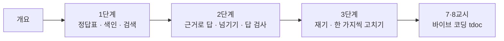

# 71일차 · RAG 기반 검색·응답 Workflow와 검색 품질 개선 (바이브 코딩)

- 일자: 2026-10-23 (71일차)
- 교과목: 노코드 멀티 에이전트 워크플로우 설계 및 운영
- 단원: 운영·확장 관점의 AI 워크플로우 설계 고도화
- 학습 내용: RAG 기반 검색·응답 Workflow 구현, 검색 품질 개선 적용
- 실습 폴더: [Last3Mon/71](../../Last3Mon/71/README.md)
- 실습 환경: 65일차 n8n 2.42.6 + OpenAI API(`gpt-4.1-mini`, 임베딩 `text-embedding-3-large`) + 71일차 데이터 API(규정 문서) + **CLI 코딩 에이전트**
- **실습 준비: [00-DAY71-PREP.md](00-DAY71-PREP.md) (수업 전날까지 1~2절 완료)**

## 오늘의 시간표

| 교시 | 시간 | 내용 | 자료 |
| --- | --- | --- | --- |
| 1 | 09:00~09:50 | 오늘의 개요 · 1단계 · RAG와 색인 | [개요](00-DAY71-OVERVIEW.md), [1단계](01-STAGE1-RAG-AND-INDEX.md) |
| 2 | 10:00~10:50 | 1단계 · Lab 01 (정답표, 색인·검색, 과제: 섹션 출처) | [Lab 01](../../Last3Mon/71/LAB-01-Q-INDEX-AND-SEARCH.md) |
| 3 | 11:00~11:50 | 2단계 · 근거로 답하는 RAG 워크플로우, Lab 02 예제 1·2 | [2단계](02-STAGE2-RAG-ANSWER.md), [Lab 02](../../Last3Mon/71/LAB-02-Q-ANSWER-FROM-POLICIES.md) |
| 4 | 12:00~12:50 | 2단계 · Lab 02 과제 35분 (점수는 높은데 답이 없을 때) · 풀이 | [Lab 02](../../Last3Mon/71/LAB-02-Q-ANSWER-FROM-POLICIES.md) |
| - | 13:00~14:00 | 점심 |  |
| 5 | 14:00~14:50 | 3단계 · 검색 품질 측정과 개선, Lab 03 예제 1·2 | [3단계](03-STAGE3-RETRIEVAL-QUALITY.md), [Lab 03](../../Last3Mon/71/LAB-03-Q-MEASURE-AND-IMPROVE.md) |
| 6 | 15:00~15:50 | 3단계 · Lab 03 과제 40분 (어려운 질문으로 고치기) · 풀이 | [Lab 03](../../Last3Mon/71/LAB-03-Q-MEASURE-AND-IMPROVE.md) |
| 7 | 16:00~16:50 | 바이브 코딩 · `tdoc` 만들기 (각자, 요청서 → SPEC 먼저) | [VIBE-REQ-TDOC](../../Last3Mon/71/VIBE-REQ-TDOC.md) → [VIBE-Q-TDOC](../../Last3Mon/71/VIBE-Q-TDOC.md), [진행](04-VIBE-CODING.md) |
| 8 | 17:00~17:50 | 바이브 코딩 발표 · 정리 · 강사 바이브 코딩 · 팁 · 72일차 예고 | [진행](04-VIBE-CODING.md) |

## 자료 목록

| 파일 | 내용 |
| --- | --- |
| `00-DAY71-PREP.md` | 실습 준비: n8n · 71일차 판 데이터 API 켜기, `flow.py doctor` (수업 전) |
| `00-DAY71-OVERVIEW.md` | 개요 23장 (PPT 대신 Markdown, 가로줄로 장 구분): 앞 일차와의 연결, 오늘의 문서, 단계마다 실측 장 |
| `01-STAGE1-RAG-AND-INDEX.md` | 왜 RAG인가(네 가지 방법 비교), 임베딩과 점수 읽기(실측), 정답표 먼저(질문 종류 · 정답표도 틀림), 청크 하나의 모양 · 메타데이터, 메모리 저장소의 한살이, 요청문 좋은 예 · 나쁜 예, 확인 질문 |
| `02-STAGE2-RAG-ANSWER.md` | LLM이 받는 발췌의 실제 모양 · 실측 답, `sources`와 `cited`, 관련도 기준 10개 · 정하는 순서 · 양쪽으로 틀림, 점수는 높은데 답이 없을 때, 답 검사 넷(계산 방법 · 결과 JSON), 넘기는 길 세 갈래, 확인 질문 |
| `03-STAGE3-RETRIEVAL-QUALITY.md` | doc@1 · answer@1 · answer@3(아슬아슬한 1등), 재는 순서 · 실험 기록, 청크 크기(잘린 문장 · 섞인 청크 · 틀린 질문이 다름), 어려운 질문 8개와 다시 쓴 검색어, 같은 설정 다른 결과, 개선 방법 고르기 · 멈출 때, 확인 질문 |
| `04-VIBE-CODING.md` | 7·8교시 바이브 코딩 진행 (tdoc), 발표, 강사 정리, 추가 바이브 코딩, 팁 |
